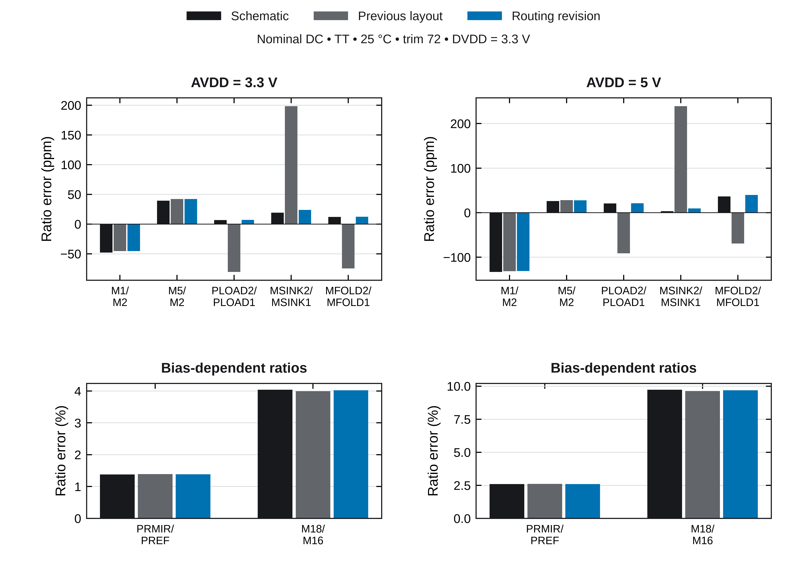

# GF180MCU Trimmed Bandgap Reference

**Jonah Saunders · Chipalooza #3 · Seven-bit resistor trim**

[Layout](#layout) · [Floorplan](#floorplan) · [Pre-layout](#pre-layout-simulation) · [Post-layout](#post-layout-simulation) · [Schematics](#schematics) · [Simulation setup](#installation-and-first-run)

A bandgap reference targeting **1.18 V** in GF180MCU-D, integrating a folded-cascode error amplifier, bias and startup circuits, a seven-bit resistor-trim network, and MIM capacitors. The complete trim-inclusive core corresponds to **TB10_RESISTOR_TRIM**.

| Technology | Core footprint | Trim | Physical verification |
| :--- | :--- | :--- | :--- |
| GF180MCU-D · 5 metals | 686.0 × 399.6 µm · 0.274 mm² | 7 bits · 128 codes | 0 reported DRC violations · LVS match |

Physical checks apply to the released core and pinned decks. This is a **layout review candidate**; integration and electrical qualification remain open.

## Layout

[](layout/figures/physical-layout.png)

**Fig. 1.** Routed and filled GDS of the complete trim-inclusive core. Sixteen numbered callouts identify the analog device groups and startup circuitry; C1–C11 identify the MIM capacitors. The dashed outline marks the deep-n-well trim region. Numbers 1–14 correspond to the matching groups in Fig. 3. The updated routing adds shared amplifier source buses and separate M5 ground reinforcement inside the unchanged footprint. This is a layout rendering, not a silicon micrograph. [Vector PDF](layout/figures/physical-layout.pdf)

## Floorplan

The organizer's draft guidance allocates approximately **1270 × 410 µm** per user area. The compact core occupies **52.6%** of that area. The two-row output-capacitor bank follows the earlier compact floorplan; the precision core sits beside the trim ladder. The added matched-device dummy surrounds account for the increase from the earlier 614 × 307.6 µm core.

[](layout/figures/harness-area-fit.png)

**Fig. 2.** Geometric fit within the draft user area. Centering leaves 292.0 µm on each side and 5.2 µm above and below. Final wrapper boundaries, required clearances, slot assignment, and pin locations remain pending. [Vector PDF](layout/figures/harness-area-fit.pdf) · [Announcement and assumptions](layout/planning_envelope.json)

[](layout/figures/implemented-floorplan.png)

**Fig. 3.** Implemented placement, drawn from the saved device coordinates. Trim logic and the resistor ladder occupy the left side. The amplifier lies below the two-row output capacitor bank, with C1 close to its sensitive output and the bias arrays grouped beside the core. The numbered legend identifies the matching groups. [Vector PDF](layout/figures/implemented-floorplan.pdf) · [Matching detail](layout/figures/matched-arrays.pdf) · [Historical initial concept](layout/figures/initial-floorplan.pdf)

## Simulation results

### Pre-layout simulation

The original **2k-resistor design** is preserved on [`design_review_1`](https://github.com/jonahsaunders/gf180mcu_jonah_saunders_ip__bandgap/tree/design_review_1). The temperature-trim chart and specification estimates below belong to that pre-layout build. Its trim codes and results should be read separately from the current 1k-resistor post-layout screens.

#### Temperature-trim study — 28 September 2026

The study covers **45 process combinations** (5 MOS × 3 BJT × 3 resistor, with typical MIM), **−40 to 125 °C**, **3.3 V and 5 V AVDD**, and **3.3 V DVDD**. All 128 codes were first compared at −40, 25, and 125 °C. The best sampled code and its two neighbors were then checked at 1 °C steps: **135/135 candidate jobs completed**, producing **44,820 DC sample points**. One selected code is held across both supplies and all temperatures for each process combination. All **14,940 selected-code operating points** meet the existing self-sustaining DC current checks.

[](docs/results/trim-temperature-2026-09-28/temperature_drift_after_trim.png)

**Fig. 4.** Original pre-layout temperature-trim results. The left chart shows drift relative to each curve's own 25 °C output; solid and dashed curves indicate 3.3 V and 5 V supplies. Each point in the right chart represents one process combination and its worst temperature coefficient across the two supplies. Typical MIM is used; mismatch and layout parasitics are excluded.

| Pre-layout result after minimum-drift calibration | Value |
| :--- | ---: |
| Typical output, 25 °C / 3.3 V | 1.18425 V |
| Output across selected temperature curves and both supplies | 1.173776–1.189448 V |
| Box temperature coefficient: best / typical / median / worst | 0.49 / 2.54 / 2.99 / 5.28 ppm/°C |
| Selected trim codes | 65–98 |

The process corner previously giving 65.5 ppm/°C when calibrated toward 1.200 V gives 3.28 ppm/°C with a different code. That earlier figure used three temperatures; this study uses the dense sweep.

The calibration objective is **minimum temperature drift**, with an output near **1.18 V**. The standard TB10 runner instead selects a code for **1.194 V at 25 °C**; it does not automatically reproduce this separate minimum-drift study. These deterministic DC results do not establish post-trim mismatch yield, startup/restart, PSRR, noise, or stability at the selected codes.

[Study details and method](docs/results/trim-temperature-2026-09-28/README.md) · [Selected codes and metrics (CSV)](docs/results/trim-temperature-2026-09-28/selected_codes.csv) · [Temperature curves (CSV)](docs/results/trim-temperature-2026-09-28/selected_curves.csv) · [Full TB01–TB10 simulation review](docs/RESULTS.md)

<a id="specifications"></a>
<a id="projected-post-trim-specifications"></a>

#### Pre-layout specification estimates

Conservative planning estimates for the resistor-trim core, with a **1.18 V nominal goal**. Select the trim code for minimum temperature drift, then hold it fixed across supply and temperature. Min / Typical / Max entries are estimated values and design budgets, not measured or guaranteed limits.

| Parameter | Min | Typical | Max | Unit |
| --- | ---: | ---: | ---: | --- |
| Analog supply voltage | 3.3 | 3.3 | 5.0 | V |
| Trim logic supply voltage (fixed) | 3.3 | 3.3 | 3.3 | V |
| Operating temperature | −40 | 25 | 125 | °C |
| Output voltage after trim (1.18 V nominal) | 1.1682 | **1.184** | 1.1918 | V |
| Analog supply current | 15 | 30 | 60 | µA |
| Load regulation† | 0.1 | 0.5 | 1 | % |
| Line regulation, 3.3-5.0 V | 0.01 | 0.02 | 0.1 | % |
| Output noise density at 1 kHz | 900 | 1,500 | 3,000 | nV/√Hz |
| Integrated noise, 0.1-10 Hz | 50 | 70 | 100 | µV RMS |
| Initial output error relative to 1.18 V | −1 | +0.36 | +1 | % |
| PSRR at 1 kHz | 55 | 75 | 85 | dB |
| PSRR throughout 1 Hz-1 MHz | 45 | 50 | 55 | dB |
| Temperature coefficient after trim | 0.5 | 3 | **10** | ppm/°C |
| Startup / restart after supply ramp† | 75 | 200 | 300 | µs |
| PTAT output current† | 180 | 220 | 260 | nA |
| Trim resolution (fixed) | 7 | 7 | 7 | bits |

Typical values are rounded estimates near nominal conditions; the 1.184 V estimate reflects calibration for minimum drift rather than exact voltage. †Load regulation, PTAT current, and startup/restart at the new codes are provisional guesses. See **[Results](docs/RESULTS.md#basis-for-the-specification-estimates)** for the estimate basis and historical simulation evidence.

### Post-layout simulation

Current results use typical device corners, trim code 72, DVDD = 3.3 V, and 25 °C unless stated otherwise. The capacitance-conserving RCC approximation now includes **analog and digital ground metal resistance**. Well/substrate resistance remains lumped, and distributed coupling placement remains approximate.

| Parameter | AVDD = 3.3 V | AVDD = 5.0 V | Unit |
| :--- | ---: | ---: | :--- |
| Reference output | 1.193160 | 1.193320 | V |
| Analog supply current | 24.06 | 31.21 | µA |
| Box temperature coefficient, −40 to 125 °C | 7.53 | 7.45 | ppm/°C |
| Minimum PSRR, 1 Hz to 1 MHz | 48.01 | 53.17 | dB |


No external output load is added. Code 72 is fixed; it is not a completed minimum-drift calibration. [Nominal data](layout/release/nominal_screen.json) · [PSRR data](layout/release/psrr/summary.json)

**Startup remains unqualified on this revision.** The expanded transient screen exceeded its 300 s per-case runtime limit. No incomplete run is counted as passing. Earlier cold-start/restart results remain in the [historical supply-sequence data](layout/release/previous/published_power_sequence_screen.json); they apply to the previous GDS and extraction model. [Current attempt status and logs](layout/release/incomplete-transients/status.json)

[](layout/figures/psrr-before-after.png)

**Fig. 5.** Controlled comparison over 481 common frequencies. With ground metal resistance included in **both** layouts, minimum PSRR improves from **45.94 to 48.01 dB** at 3.3 V and **48.66 to 53.17 dB** at 5 V. Both use Magic 8.3.685, identical terminal anchoring, and the same RCC conservation method. The earlier published 48.10/53.37 dB values omitted ground resistance; those results are retained separately and are not the baseline for the physical gain. [Vector PDF](layout/figures/psrr-before-after.pdf) · [Extraction explanation and comparison](layout/reviews/2026-10-21-compact-routing/README.md#psrr-and-the-extraction-correction)

### Mirror layout and matching

The **686.0 × 399.6 µm** placement is unchanged. The routing revision adds shared 2 µm source buses for the amplifier load and sink pairs, reinforces separate AVSS/DVSS returns with M5 and redundant vias, and keeps unrelated wires off R1 and the PNP-array region. All 13 MOS dummy surrounds remain intact. The actual-GDS audit finds zero unrelated-net crossings over the matched MOS channels and R1's resistor body; Q1/Q2 retain coincident emitter centroids and equal unit areas.

At 3.3 V, nominal load-pair error falls from **0.0081% to 0.0007%** and sink-pair error from **0.0198% to 0.0024%**. The main mirror changes only slightly. All seven ratios, including the larger bias-dependent errors, are reported below and in the detailed comparison. All 272 functional units and 261 tied-off dummy units retain their models, dimensions and connections.

[](layout/reviews/2026-10-21-compact-routing/mirror-current-ratios.png)

**Fig. 6.** Nominal DC current-ratio errors from independent drain probes, with the same ground-inclusive extraction for both layouts. These are deterministic comparisons, not statistical mismatch predictions. Source-path resistance, terminal biases and remaining asymmetries are documented in the [routing review](layout/reviews/2026-10-21-compact-routing/README.md). [Per-unit currents](layout/release/mirror_bias/summary.json) · [Precision-layout audit](layout/release/precision_layout_audit.json)

**Verification and qualification.** The complete unedited core DRC deck reports **0 violations**, LVS matches all **533 units**, both extraction-topology LVS audits pass, and an independent source rebuild has zero geometry/text differences. All **360 fixed-code corner DC points** complete; **2 of 90 cases** retain recovered solver-fallback warnings. Neither schematic nor layout meets the existing 60 dB testbench PSRR criterion. Startup/restart, statistical matching/trim yield, independent PEX accuracy, distributed well/substrate resistance, EM/IR, stability, noise, loading and final harness integration remain open. [Release evidence](layout/release/verification.json) · [Detailed report](layout/report.html) · [Design budgets](docs/REFERENCE_SPECIFICATIONS.md)

## Schematics

[](docs/images/bandgap-core-resistor-trim.svg)

**Fig. 7.** Functional circuit of the final resistor-trim bandgap reference, exported directly from the saved Xschem schematic. The full sheet, including the native dummy transistor symbols, is available below. [Full-resolution functional schematic](docs/images/bandgap-core-resistor-trim.svg)

**[View the complete final Xschem schematic, including trim and all dummy transistors](docs/SCHEMATICS.md)** · [Full-resolution vector image](docs/images/bandgap-core-resistor-trim-complete.svg)

The final trim-inclusive core contains **13 native dummy transistor symbols**, representing **261 dummy units**, in the editable Xschem source. The linked page shows the entire sheet and separate functional-circuit and dummy close-ups. The exported source matches the [LVS-checked schematic](layout/release/schematic-symbols/verification.json), with all **533 device units** retained.

| Circuit | Xschem source |
| :--- | :--- |
| Final core — seven-bit resistor trim and native dummy transistors | [Bandgap_Core_Res.sch](Bandgap_Core_Res.sch) |
| Final trim-inclusive testbench | [TB10_RESISTOR_TRIM.sch](TB10_RESISTOR_TRIM.sch) |
| Untrimmed reference core | [Bandgap_Core.sch](Bandgap_Core.sch) |

## Installation and first run

### 1. Open the simulation environment

Use **Bash inside Linux/FOSS**, with Python 3.9+, Xschem, ngspice, and the GF180 symbol/model libraries installed. The runner uses POSIX file locks and does not run directly in Windows PowerShell. The PDK is installed separately.

In IIC-OSIC-TOOLS, use the full PDK selector in the same terminal before opening Xschem:

```bash
source /foss/tools/sak/sak-pdk-script.sh gf180mcuD
command -v python3 xschem ngspice
```

This sets `PDK`, `PDKPATH`, and ngspice startup settings together. The interactive alias is `sak-pdk gf180mcuD`; sourcing its script also works in Bash scripts. Repeat the selection in each new terminal.

The testbench model paths assume `/foss/pdks/gf180mcuD/libs.tech/ngspice/`. If your PDK is elsewhere, update each bench's `MODELS` paths before netlisting.

### 2. Get the project and Python dependencies

```bash
cd /foss/designs
git clone https://github.com/jonahsaunders/gf180mcu_jonah_saunders_ip__bandgap.git
cd gf180mcu_jonah_saunders_ip__bandgap

python3 -m venv .venv
source .venv/bin/activate
python3 -m pip install -r requirements.txt
python3 verify_suite.py
```

For an existing checkout, start in its repository folder. When reviewing an unmerged branch, switch to that branch before installation. Keep the core `.sch`/`.sym` files, benches, scripts, and `bandgap_config.json` together. The virtual environment is optional if NumPy and Matplotlib are already installed. Software checks do not simulate the circuit.

### 3. Configure the Xschem launchers

Close open testbenches, then run:

```bash
NETLIST_DIR="/headless/.xschem/simulations"
mkdir -p "$NETLIST_DIR"
python3 run_bandgap.py --configure --netlist-dir "$NETLIST_DIR"
```

Use your actual Xschem netlist directory. Reopen the benches afterward. Repeat this step after moving the repository; it updates launcher paths, not core circuitry or PDK model paths.

### 4. Run a smoke check

Generate TB01's netlist, run its short profile, and plot the results:

```bash
source /foss/tools/sak/sak-pdk-script.sh gf180mcuD
NETLIST_DIR="${NETLIST_DIR:-/headless/.xschem/simulations}"
mkdir -p "$NETLIST_DIR"
xschem -n -x -q -r -s -o "$NETLIST_DIR" \
  -N TB01_PSRR.spice TB01_PSRR.sch

python3 run_bandgap.py --test TB01_PSRR \
  --deck "$NETLIST_DIR/TB01_PSRR.spice" --profile smoke

python3 plot_bandgap.py --profile smoke --test TB01_PSRR
```

Check for missing-symbol or netlisting errors before running the Python command. The report is `results/smoke/TB01_PSRR_UPLOAD_THIS.txt`; plots are in `results/smoke/plots/`. Regenerate the matching netlist whenever its schematic changes.

For GUI runs, select GF180 and open a bench from that same terminal. Relaunch any Xschem window that previously loaded another PDK. Then click **Netlist**, then **Simulate**. Each schematic runs only its own bench. GUI profiles come from `bandgap_config.json`; the supplied defaults select **full**, including TB10. A terminal `--profile smoke` command does not change those defaults.

For the full-suite command, profile settings, troubleshooting, and **rerunning selected cases without replacing old results**, use the [simulation guide](docs/SIMULATION_GUIDE.md).

## Documentation

| Resource | Contents |
| :--- | :--- |
| [Layout reproduction](layout/README.txt) | Pinned tools, build flow, extraction assumptions, and open work |
| [Release verification](layout/release/verification.json) | DRC/LVS results, tool versions, and source/artifact hashes |
| [Compact routing review](layout/reviews/2026-10-21-compact-routing/README.md) | Source buses, ground returns, mirror matching and controlled PSRR comparison |
| [Previous matching revision](layout/reviews/2026-10-21-mirrors-implemented/README.md) | Preserved dummy-array and placement results before this routing revision |
| [Historical mirror audit](layout/reviews/2026-10-21-mirrors/README.md) | Original compact layout and the findings that motivated this revision |
| [Figure exports](layout/figures) | Eight current figures in PDF, SVG, and 600-dpi PNG; captions included |
| [Testbench reference](docs/TESTBENCHES.md) | TB01–TB10 and measurement coverage |
| [Software validation](VALIDATION.md) | Runner, parser, and plotting checks |
| [Historical simulation results](docs/RESULTS.md) | Results from the original 2k-resistor build |

The current `main` branch uses the PDK's `ppolyf_u_1k` model, with resistor lengths doubled to preserve nominal resistance. The original build is retained on [`design_review_1`](https://github.com/jonahsaunders/gf180mcu_jonah_saunders_ip__bandgap/tree/design_review_1); the [design-review notes](docs/DESIGN_REVIEW.md) explain the conversion and Python readability changes.
