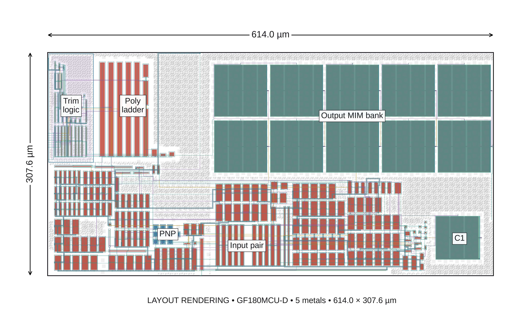
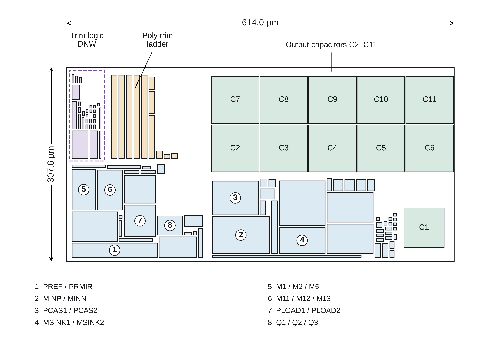
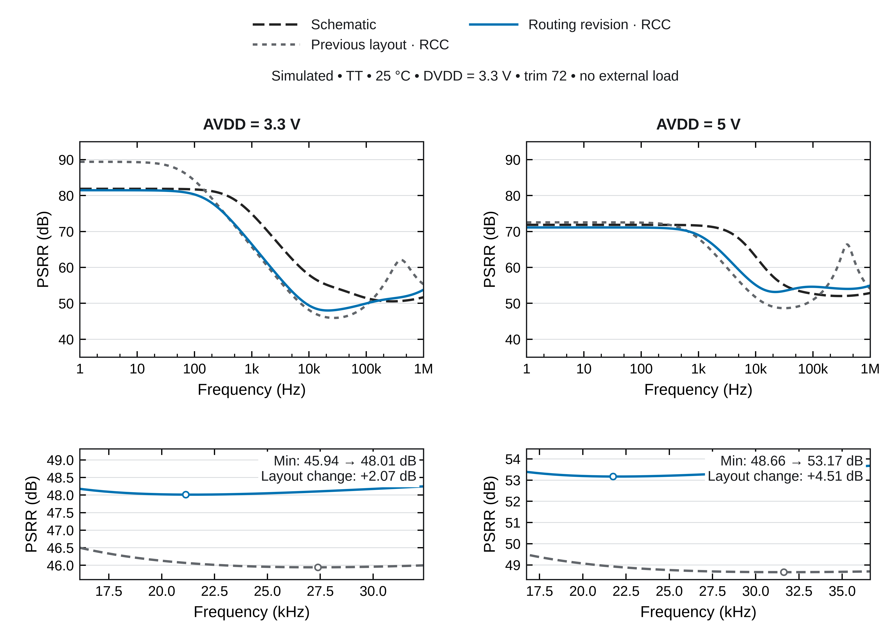
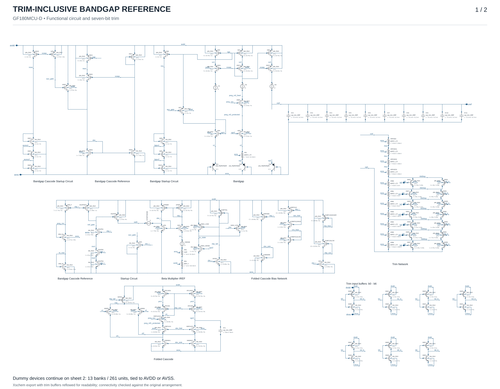

# GF180MCU Trimmed Bandgap Reference

Jonah Saunders · Chipalooza #3

A bandgap reference targeting 1.18 V in GF180MCU-D, with a folded-cascode amplifier, startup circuit, and seven-bit resistor trim. Includes Xschem schematics, ten ngspice testbenches, and Python tools for running and plotting simulations.

**Status:** layout review candidate. The released core has 0 reported DRC violations with the pinned deck and an LVS match across all 533 device units. Electrical qualification and harness integration remain open.

## Layout

686.0 × 399.6 µm (0.274 mm²), including the trim network and MIM capacitors. [Vector PDF](layout/figures/physical-layout.pdf)

### Floorplan

Trim logic and the resistor ladder sit beside the analog core, with the output capacitors above the amplifier. The core fits the draft 1270 × 410 µm user area; final boundaries, clearances, and pin locations are pending. [Area fit](layout/figures/harness-area-fit.png) · [Floorplan PDF](layout/figures/implemented-floorplan.pdf)

The latest routing adds shared amplifier source buses and reinforces the ground returns. See the [routing and matching review](layout/reviews/2026-10-21-compact-routing/README.md) for current-ratio comparisons and the layout audit.

## Simulation results

### Post-layout simulation

Typical device corners, trim code 72, DVDD = 3.3 V, and no external output load. Values are at 25 °C except for the temperature sweep.

| Parameter | AVDD = 3.3 V | AVDD = 5.0 V |
| :--- | ---: | ---: |
| Reference output | 1.193160 V | 1.193320 V |
| Analog supply current | 24.06 µA | 31.21 µA |
| Box temperature coefficient, −40 to 125 °C | 7.53 ppm/°C | 7.45 ppm/°C |
| Minimum PSRR, 1 Hz to 1 MHz | 48.01 dB | 53.17 dB |

Code 72 is fixed, not calibrated for minimum drift. The RCC extraction approximation includes ground-metal resistance; well/substrate resistance is lumped and coupling placement is approximate.

Both layouts use the same ground-inclusive extraction method. Neither schematic nor layout meets the testbench's 60 dB PSRR criterion. [Nominal data](layout/release/nominal_screen.json) · [PSRR data](layout/release/psrr/summary.json)

**Startup is not yet qualified:** the latest transient screen hit its runtime limit. Trim yield, stability, noise, loading, EM/IR, and independent extraction validation also remain open. [Verification report](layout/release/verification.json) · [Startup logs](layout/release/incomplete-transients/status.json)

### Pre-layout simulation

The [original 2k-resistor build](https://github.com/jonahsaunders/gf180mcu_jonah_saunders_ip__bandgap/tree/design_review_1) was calibrated for minimum temperature drift across 45 process combinations, −40 to 125 °C, and both supplies. Typical output was 1.18425 V; typical/worst box temperature coefficients were 2.54/5.28 ppm/°C. These results exclude mismatch and layout parasitics and do not apply to the current 1k-resistor layout. The standard TB10 runner targets 1.194 V at 25 °C and does not reproduce this separate study.

[Temperature-trim study and plots](docs/results/trim-temperature-2026-09-28/README.md) · [Pre-layout design estimates—not guaranteed limits](docs/REFERENCE_SPECIFICATIONS.md) · [Full simulation review](docs/RESULTS.md)

## Schematics

[Complete schematic, including dummy devices](docs/SCHEMATICS.md) · [Editable core](Bandgap_Core_Res.sch) · [Trim testbench](TB10_RESISTOR_TRIM.sch) · [Untrimmed core](Bandgap_Core.sch)

## Installation and first run

Use Bash in Linux/FOSS with Python 3.9+, Xschem, ngspice, and the GF180MCU-D PDK installed.

Follow the [setup and smoke-check instructions](docs/GETTING_STARTED.md), then the [simulation guide](docs/SIMULATION_GUIDE.md) for full runs, profiles, and reruns.

## Documentation

- [Layout reproduction](layout/README.txt) — tools, build steps, and extraction assumptions
- [Layout report](layout/report.html) — physical verification and open work
- [Testbench reference](docs/TESTBENCHES.md) — TB01–TB10
- [Software validation](VALIDATION.md) — runner, parser, and plotting checks
- [Design-review notes](docs/DESIGN_REVIEW.md) — 2k-to-1k resistor conversion
