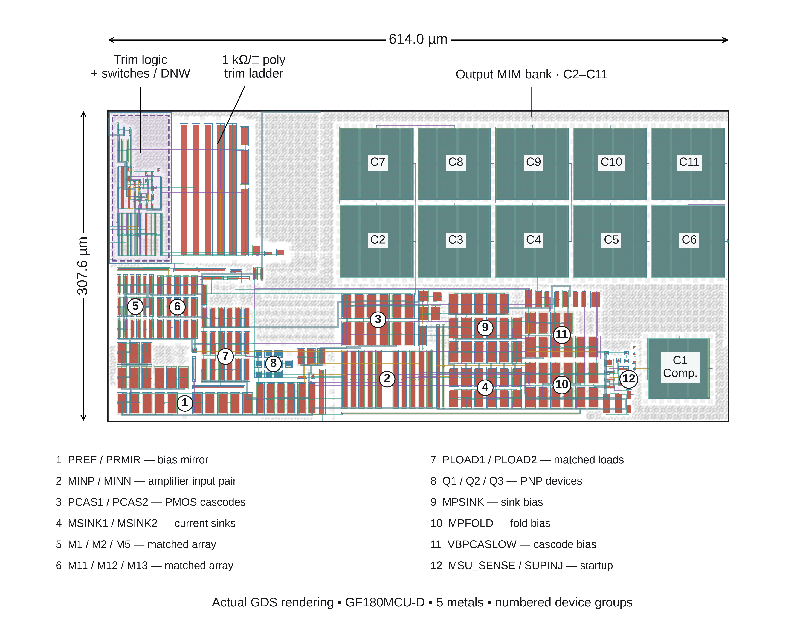
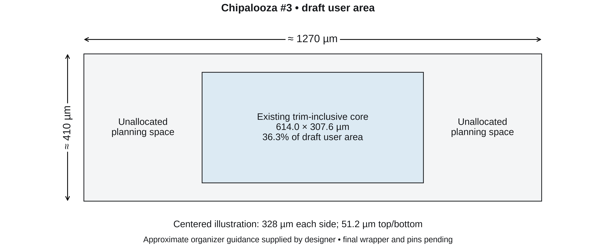
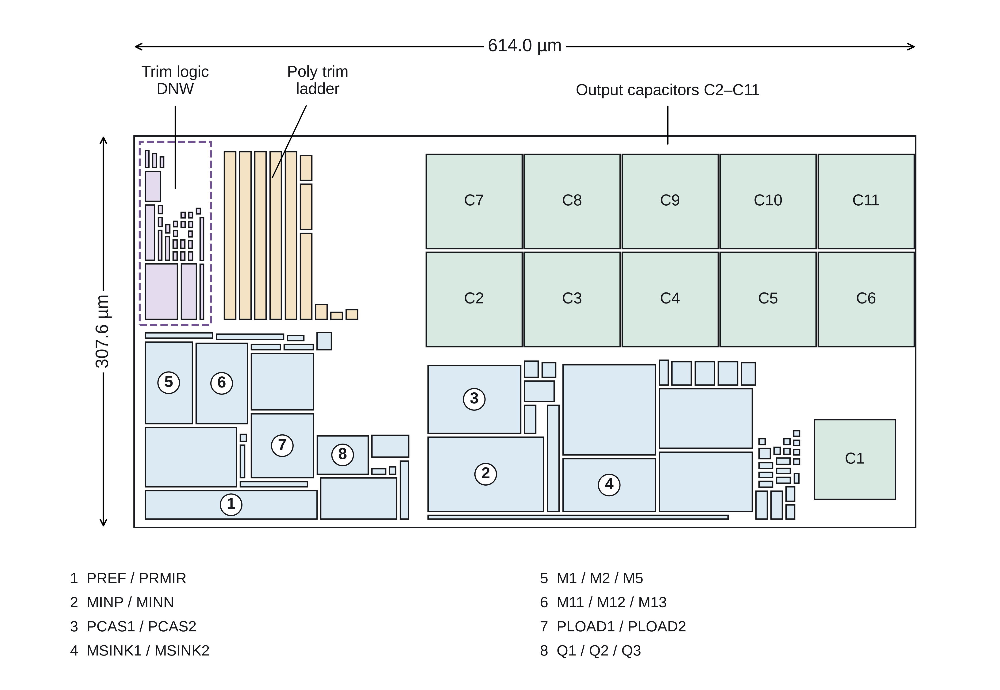
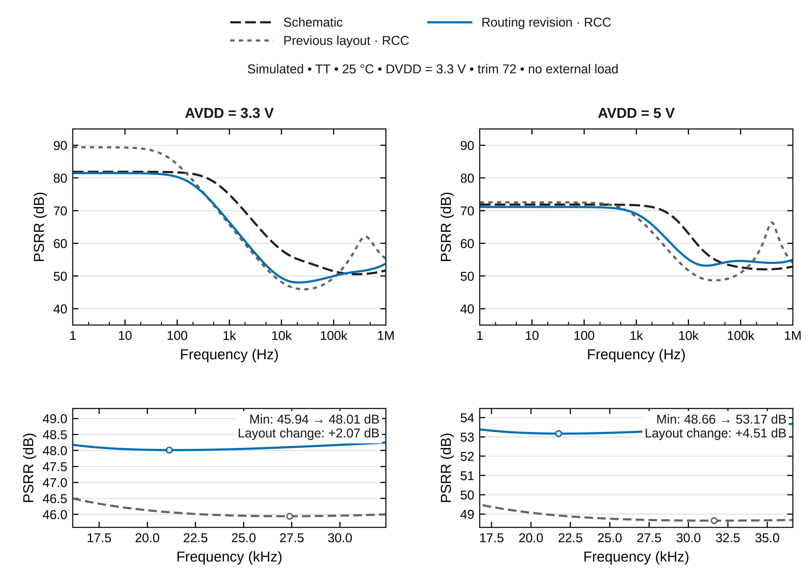
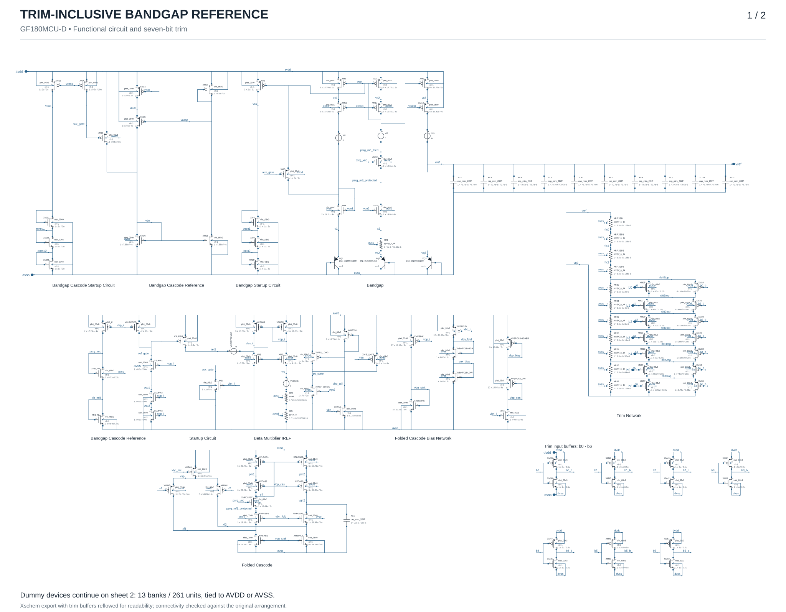

# GF180MCU Trimmed Bandgap Reference

**Jonah Saunders · Chipalooza #3 · Seven-bit resistor trim**

[Layout](#layout) · [Floorplan](#floorplan) · [Simulation results](#simulation-results) · [Schematics](#schematics) · [Reproduce](#installation-and-first-run)

A bandgap reference targeting **1.18 V** in GF180MCU-D, integrating a folded-cascode error amplifier, bias and startup circuits, a seven-bit resistor-trim network, and MIM capacitors. The complete trim-inclusive core corresponds to **TB10_RESISTOR_TRIM**.

| Technology | Core footprint | Trim | Physical verification |
| :--- | :--- | :--- | :--- |
| GF180MCU-D · 5 metals | 614 × 307.6 µm · 0.189 mm² | 7 bits · 128 codes | 0 reported DRC violations · LVS match |

Physical checks apply to the released core and pinned decks. This is a **layout review candidate**; integration and electrical qualification remain open.

## Layout

**Fig. 1.** Routed and filled GDS of the complete trim-inclusive core. Twelve numbered callouts identify the analog device groups and startup circuitry; C1–C11 identify the MIM capacitors. The dashed outline marks the deep-n-well trim region. Numbers 1–8 correspond to the matching groups in Fig. 3. This is a layout rendering, not a silicon micrograph. [Vector PDF](layout/figures/physical-layout.pdf)

## Floorplan

The organizer's draft guidance, supplied by the designer on 20 October 2026, allocates approximately **1270 × 410 µm** per user area. The present core occupies **36.3%** of that area. The analog core remains compact, with space available for harness connections, supply routing, isolation, and later matching improvements.

**Fig. 2.** Geometric fit within the draft user area. Centering leaves 328 µm on each side and 51.2 µm above and below the core. These are geometric margins; final wrapper boundaries, required clearances, slot assignment, and pin locations remain pending. [Vector PDF](layout/figures/harness-area-fit.pdf) · [Announcement and assumptions](layout/planning_envelope.json)

**Fig. 3.** Implemented placement, drawn from the saved device coordinates. Trim logic and the resistor ladder occupy the left side; the analog groups lie below the output capacitor bank, with C1 at the right. The numbered legend identifies the matching groups. [Vector PDF](layout/figures/implemented-floorplan.pdf) · [Matching detail](layout/figures/matched-arrays.pdf) · [Historical initial concept](layout/figures/initial-floorplan.pdf)

## Simulation results

Current **post-layout simulation** results use typical device corners, trim code 72, DVDD = 3.3 V, and 25 °C unless stated otherwise. The extracted model uses a capacitance-conserving RCC approximation; ground resistance is omitted, and distributed coupling placement remains approximate. These are simulated screening results.

| Parameter | AVDD = 3.3 V | AVDD = 5.0 V | Unit |
| :--- | ---: | ---: | :--- |
| Reference output | 1.194404 | 1.194579 | V |
| Analog supply current | 24.33 | 31.67 | µA |
| Box temperature coefficient, −40 to 125 °C | 10.08 | 10.01 | ppm/°C |
| Minimum PSRR, 1 Hz to 1 MHz | 47.20 | 52.16 | dB |
| Cold-start settling, both rails cycled | 200.5 | 110.6 | µs |
| Restart settling, both rails cycled | 109.3 | 47.4 | µs |

Settling is measured to ±0.5% of the final value after a 100 µs supply ramp, with high trim inputs following DVDD and no external output load. Code 72 is fixed for these screens; it is not a completed minimum-drift calibration. [Nominal data](layout/release/nominal_screen.json) · [PSRR data](layout/release/psrr/summary.json) · [Supply-sequence data](layout/release/power_sequence_screen.json)

**Fig. 4.** PSRR comparison at both analog supply voltages. Correcting the extraction accounts for most of the apparent recovery; the physical routing revision improves the minimum by approximately 0.24–0.25 dB. The remaining 3.3 V gap to the schematic minimum is 3.36 dB. [Vector PDF](layout/figures/psrr-before-after.pdf) · [Comparison data](layout/release/psrr/comparison.json)

**Qualification status.** The nominal screens exceed the 45 dB planning floor, but neither the schematic nor the layout meets the existing 60 dB testbench PSRR criterion. At code 72, the output exceeds the 1.18 V ±1% budget and the temperature coefficient is slightly above 10 ppm/°C. Final harness integration, complete ground-network extraction, matching and route review, EM/IR, and full analog qualification remain open. See the [reference design budgets](docs/REFERENCE_SPECIFICATIONS.md), [release evidence](layout/release/verification.json), and [detailed review report](layout/report.html).

## Schematics

| Circuit | Schematic image | Xschem source |
| :--- | :--- | :--- |
| Trim-inclusive core used for layout | [Full-size SVG](docs/images/bandgap-core-resistor-trim.svg) | [Bandgap_Core_Res.sch](Bandgap_Core_Res.sch) |
| Untrimmed reference core | [Full-size SVG](docs/images/bandgap-core.svg) | [Bandgap_Core.sch](Bandgap_Core.sch) |
| Seven-bit resistor-trim testbench | [Testbench guide](docs/TESTBENCHES.md) | [TB10_RESISTOR_TRIM.sch](TB10_RESISTOR_TRIM.sch) |

View the trim-inclusive schematic

## Installation and first run

Use Bash in a Linux/FOSS environment with Xschem, ngspice, Python, and the GF180MCU-D PDK. The [installation guide](docs/GETTING_STARTED.md) covers environment selection, dependencies, launcher configuration, and the first smoke check. The [simulation guide](docs/SIMULATION_GUIDE.md) covers full-suite runs, profiles, and troubleshooting.

| Resource | Contents |
| :--- | :--- |
| [Layout reproduction](layout/README.txt) | Pinned tools, build flow, extraction assumptions, and open work |
| [Release verification](layout/release/verification.json) | DRC/LVS results, tool versions, and source/artifact hashes |
| [Figure exports](layout/figures) | Nine figures in PDF, SVG, and 600-dpi PNG; captions included |
| [Testbench reference](docs/TESTBENCHES.md) | TB01–TB10 and measurement coverage |
| [Software validation](VALIDATION.md) | Runner, parser, and plotting checks |
| [Historical simulation results](docs/RESULTS.md) | Results from the original 2k-resistor build |

The current `main` branch uses the PDK's `ppolyf_u_1k` model, with resistor lengths doubled to preserve nominal resistance. The original build is retained on [`design_review_1`](https://github.com/jonahsaunders/gf180mcu_jonah_saunders_ip__bandgap/tree/design_review_1); the [design-review notes](docs/DESIGN_REVIEW.md) explain the conversion and Python readability changes.
