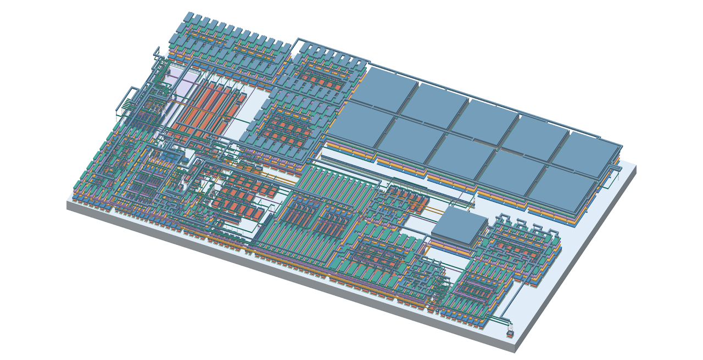
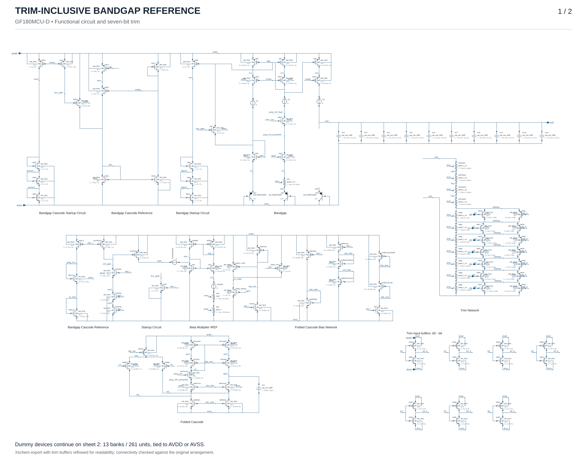

# GF180MCU Trimmed Bandgap Reference

**Jonah Saunders · Chipalooza #3 · Seven-bit resistor trim**

[Layout](#layout) · [Floorplan](#floorplan) · [Pre-layout](#pre-layout-simulation) · [Post-layout](#post-layout-simulation) · [Schematics](#schematics) · [Simulation setup](GETTING_STARTED.md)

A bandgap reference targeting **1.18 V** in GF180MCU-D, integrating a folded-cascode error amplifier, bias and startup circuits, a seven-bit resistor-trim network, and MIM capacitors. The complete trim-inclusive core corresponds to **TB10_RESISTOR_TRIM**.

| Technology | Core footprint | Trim | Physical verification |
| :--- | :--- | :--- | :--- |
| GF180MCU-D · 5 metals | 682.8 × 396.76 µm · 0.271 mm² | 7 bits · 128 codes | 0 reported DRC violations · LVS match |

Physical checks apply to the released core and pinned decks. This is a **layout review candidate**; integration and electrical qualification remain open.

## Layout

The 13 November power-rail revision has a **682.8 × 396.76 µm** routed and filled core. Device placement, circuit sizes and all 533 expanded device units are unchanged. The preview and [GLB model](../layout/release/model/bandgap-layout.glb) are generated from the verified GDS; XY geometry is exact, while layer heights are illustrative. [Physical checks and model provenance](POWER_RAIL_REVIEW.md).

The [October annotated layout and figures](https://github.com/jonahsaunders/gf180mcu_jonah_saunders_ip__bandgap/blob/design_review_2/docs/DESIGN.md#layout) remain historical on `design_review_2`.

## Floorplan

Against the organizer's provisional **1270 × 410 µm** planning area, the new core occupies **52.0%**. Centering would leave **293.6 µm** horizontally on each side and **6.62 µm** vertically. These are geometric margins, not verified integration clearances. Device coordinates and the two-row output-capacitor bank are unchanged. [Planning assumptions](../layout/planning_envelope.json).

The block is assigned to **slot 4**. The slot layout matches the wrapper's outline and pins and passes DRC and LVS on its own ([slot 4 integration](SLOT4_INTEGRATION.md)); it still needs the harness top-level checks. See [harness integration instructions](../README.md#chipalooza-harness-integration).

## Simulation results

### Pre-layout simulation

The original **2k-resistor design** is preserved on [`design_review_1`](https://github.com/jonahsaunders/gf180mcu_jonah_saunders_ip__bandgap/tree/design_review_1). The temperature-trim chart and specification estimates below belong to that pre-layout build. Its trim codes and results should be read separately from the current 1k-resistor post-layout screens.

#### Temperature-trim study — 28 September 2026

The study covers **45 process combinations** (5 MOS × 3 BJT × 3 resistor, with typical MIM), **−40 to 125 °C**, **3.3 V and 5 V AVDD**, and **3.3 V DVDD**. All 128 codes were first compared at −40, 25, and 125 °C. The best sampled code and its two neighbors were then checked at 1 °C steps: **135/135 candidate jobs completed**, producing **44,820 DC sample points**. One selected code is held across both supplies and all temperatures for each process combination. All **14,940 selected-code operating points** meet the existing self-sustaining DC current checks.

**Fig. 4.** Original pre-layout temperature-trim results. The left chart shows drift relative to each curve's own 25 °C output; solid and dashed curves indicate 3.3 V and 5 V supplies. Each point in the right chart represents one process combination and its worst temperature coefficient across the two supplies. Typical MIM is used; mismatch and layout parasitics are excluded.

| Pre-layout result after minimum-drift calibration | Value |
| :--- | ---: |
| Typical output, 25 °C / 3.3 V | 1.18425 V |
| Output across selected temperature curves and both supplies | 1.173776–1.189448 V |
| Box temperature coefficient: best / typical / median / worst | 0.49 / 2.54 / 2.99 / 5.28 ppm/°C |
| Selected trim codes | 65–98 |

The process corner previously giving 65.5 ppm/°C when calibrated toward 1.200 V gives 3.28 ppm/°C with a different code. That earlier figure used three temperatures; this study uses the dense sweep.

The calibration objective is **minimum temperature drift**, with an output near **1.18 V**. The standard TB10 runner instead selects a code for **1.194 V at 25 °C**; it does not automatically reproduce this separate minimum-drift study. These deterministic DC results do not establish post-trim mismatch yield, startup/restart, PSRR, noise, or stability at the selected codes.

[Study details and method](results/trim-temperature-2026-09-28/README.md) · [Selected codes and metrics (CSV)](results/trim-temperature-2026-09-28/selected_codes.csv) · [Temperature curves (CSV)](results/trim-temperature-2026-09-28/selected_curves.csv) · [Full TB01–TB10 simulation review](RESULTS.md)

#### Pre-layout specification estimates

Conservative planning estimates for the resistor-trim core, with a **1.18 V nominal goal**. Select the trim code for minimum temperature drift, then hold it fixed across supply and temperature. Min / Typical / Max entries are estimated values and design budgets, not measured or guaranteed limits.

| Parameter | Min | Typical | Max | Unit |
| --- | ---: | ---: | ---: | --- |
| Analog supply voltage | 3.3 | 3.3 | 5.0 | V |
| Trim logic supply voltage (fixed) | 3.3 | 3.3 | 3.3 | V |
| Operating temperature | −40 | 25 | 125 | °C |
| Output voltage after trim (1.18 V nominal) | 1.1682 | **1.184** | 1.1918 | V |
| Analog supply current | 15 | 30 | 60 | µA |
| Load regulation† | 0.1 | 0.5 | 1 | % |
| Line regulation, 3.3-5.0 V | 0.01 | 0.02 | 0.1 | % |
| Output noise density at 1 kHz | 900 | 1,500 | 3,000 | nV/√Hz |
| Integrated noise, 0.1-10 Hz | 50 | 70 | 100 | µV RMS |
| Initial output error relative to 1.18 V | −1 | +0.36 | +1 | % |
| PSRR at 1 kHz | 55 | 75 | 85 | dB |
| PSRR throughout 1 Hz-1 MHz | 45 | 50 | 55 | dB |
| Temperature coefficient after trim | 0.5 | 3 | **10** | ppm/°C |
| Startup / restart after supply ramp† | 75 | 200 | 300 | µs |
| PTAT output current† | 180 | 220 | 260 | nA |
| Trim resolution (fixed) | 7 | 7 | 7 | bits |

Typical values are rounded estimates near nominal conditions; the 1.184 V estimate reflects calibration for minimum drift rather than exact voltage. †Load regulation, PTAT current, and startup/restart at the new codes are provisional guesses. See **[Results](RESULTS.md#basis-for-the-specification-estimates)** for the estimate basis and historical simulation evidence.

### Post-layout simulation

The [13 November power-rail review](POWER_RAIL_REVIEW.md) is the current source for before/after results and limitations. Both original `main` and the new rails were rebuilt and extracted with the same toolchain. Typical corners, trim 72, DVDD 3.3 V and 25 °C are used below, without an external output load.

| RCC parameter | AVDD = 3.3 V | AVDD = 5.0 V | Unit |
| :--- | ---: | ---: | :--- |
| Reference output | 1.193159 | 1.193322 | V |
| Analog supply current | 24.2625 | 31.5889 | µA |
| Box temperature coefficient, −40 to 125 °C | 7.5278 | 7.4506 | ppm/°C |
| Minimum PSRR, 481 points from 1 Hz to 1 MHz | 47.9886 | 53.1037 | dB |

Code 72 is fixed; these are not minimum-drift calibrated results. RCC conserves the C-only net-pair capacitance matrix while retaining extracted resistance. Well/substrate resistance remains lumped and coupling placement is approximate. [Nominal data](../layout/release/nominal_screen.json) · [PSRR diagnostics](../layout/release/psrr_diagnostics/summary.json).

Most supply-path resistances improve substantially; the M1/M2/M5 supply path falls about 95%. Amplifier bias moves closer to schematic values. **Not every metric improves:** four source paths get more resistive, minimum RCC PSRR falls by 0.023 / 0.064 dB, supply current rises 0.82% / 1.20%, and numerically integrated noise from finite spectra rises about 2.2%. Both layouts have substantial output droop at a 1 µA load. The detailed review retains these regressions and the native noise-integration limitation.

**Four nominal RCC startup/restart cases complete and pass the functional check**, covering 3.3/5 V AVDD, analog-only cycling and simultaneous analog/digital cycling, at TT/25 °C/trim 72. No forced initial-state kick is used. All four baseline cases time out after the same 600 s wall-clock limit and remain incomplete; no comparative physical startup-speed claim follows from a solver timeout. Full PVT/ramp-rate/load qualification remains open. [Waveform conditions and results](POWER_RAIL_REVIEW.md#startup-and-restart).

### Mirror layout and matching

Device placement, model sizes, unit counts and dummy surrounds are unchanged by the power-rail revision. All 272 functional units and 261 dummy units are retained. The independent [mirror geometry audit](../layout/release/mirror_review/mirror_geometry_audit.json), [per-device bias results](../layout/release/mirror_bias/summary.json), and [precision/source-resistance audit](../layout/release/precision_layout_audit.json) accompany the released GDS. Nominal matching and geometry checks do not establish random mismatch yield.

**Verification scope:** complete unmodified core DRC reports **0 violations**, LVS matches **533 units**, and both extraction-topology audits pass. All **360 fixed-code corner DC points** and ten nominal DC/AC cases complete. The new corner screen has no recovered convergence warnings. Neither schematic nor layout meets the original 60 dB testbench PSRR criterion. Full startup PVT, mismatch/trim yield, independent PEX accuracy, distributed well/substrate RC, EM/IR, stability, terminal-voltage limits and final harness integration remain open. Additional noise/line/load outcomes are documented in the [review](POWER_RAIL_REVIEW.md#noise-line-and-load-screens). [Release manifest](../layout/release/verification.json) · [Detailed report](../layout/report.html).

The older October routing comparisons, plots and archived simulation history remain available in [design_review_2](https://github.com/jonahsaunders/gf180mcu_jonah_saunders_ip__bandgap/blob/design_review_2/docs/DESIGN.md#post-layout-simulation).

## Schematics

**Fig. 7.** Functional circuit of the final resistor-trim bandgap reference, exported directly from the saved Xschem schematic. The full sheet, including the native dummy transistor symbols, is available below. [Full-resolution functional schematic](images/bandgap-core-resistor-trim.svg)

**[View the complete final Xschem schematic, including trim and all dummy transistors](SCHEMATICS.md)** · [Full-resolution vector image](images/bandgap-core-resistor-trim-complete.svg)

The final trim-inclusive core contains **13 native dummy transistor symbols**, representing **261 dummy units**, in the editable Xschem source. The linked page shows the entire sheet and separate functional-circuit and dummy close-ups. The unchanged source retains the historical [schematic-representation equivalence check](../layout/release/schematic-symbols/verification.json), with all **533 device units** retained.

| Circuit | Xschem source |
| :--- | :--- |
| Final core — seven-bit resistor trim and native dummy transistors | [Bandgap_Core_Res.sch](../Bandgap_Core_Res.sch) |
| Final trim-inclusive testbench | [TB10_RESISTOR_TRIM.sch](../TB10_RESISTOR_TRIM.sch) |
| Untrimmed reference core | [Bandgap_Core.sch](../Bandgap_Core.sch) |

## Simulation setup

See [Installation and first run](GETTING_STARTED.md) and the [simulation guide](SIMULATION_GUIDE.md).

