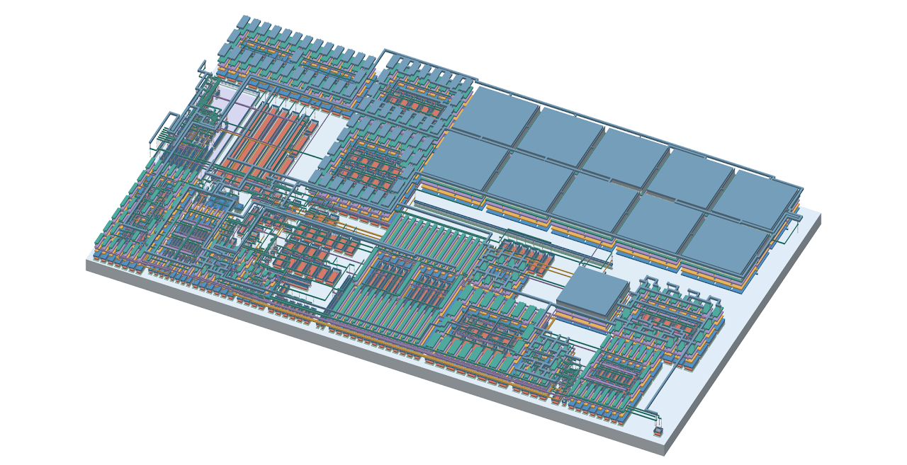

# Power-rail review - 13 November 2026

The power-rail revision is a useful improvement, but it does **not improve every metric**. Most source-to-supply resistances fall substantially, amplifier bias is closer to the schematic, and four nominal cold-start/restart simulations now complete. DRC and LVS remain clean. Four source paths get more resistive, minimum PSRR falls slightly, supply current rises, and the finite noise spectra are modestly worse. This remains a core review candidate, not tapeout signoff.

## Scope and reproducibility

- Baseline: original `main`, [`0818d5f`](https://github.com/jonahsaunders/gf180mcu_jonah_saunders_ip__bandgap/commit/0818d5f8d65c6bd1c25f599b13a52347e6589f04), preserved as [`design_review_2`](https://github.com/jonahsaunders/gf180mcu_jonah_saunders_ip__bandgap/tree/design_review_2).
- Rail implementation: [`9bb0e18`](https://github.com/jonahsaunders/gf180mcu_jonah_saunders_ip__bandgap/commit/9bb0e18631cc6bb1182dafeda5009b7d5f93b0d7). Review commits add checks, documentation and rendering; they do not change the physical rail implementation.
- Fresh build/extraction/simulation: [`0268fc2`](https://github.com/jonahsaunders/gf180mcu_jonah_saunders_ip__bandgap/commit/0268fc2f1b5e7ac12ccda2263d9621e33fe40c39), [workflow run](https://github.com/jonahsaunders/gf180mcu_jonah_saunders_ip__bandgap/actions/runs/43447797955).
- Complete raw evidence for both fresh builds: [`91f91d2`](https://github.com/jonahsaunders/gf180mcu_jonah_saunders_ip__bandgap/tree/91f91d2790787b5433cac2caa9c33a3762611421). The temporary branch was removed after publication. Original noise attempts in that snapshot are superseded by the Sparse rerun below; they remain visible rather than being reported as passes.
- Final noise rerun, 3D geometry and release validation: [workflow run](https://github.com/jonahsaunders/gf180mcu_jonah_saunders_ip__bandgap/actions/runs/43455161590), using source [`2fe5631`](https://github.com/jonahsaunders/gf180mcu_jonah_saunders_ip__bandgap/commit/2fe56311c223a818ac94b098dcf6617049bfb710).

Both layouts were rebuilt from source in the same pinned IIC-OSIC container, with the same GF180MCU-D PDK and unmodified DRC/LVS decks. Both were freshly extracted with Magic 8.3.685. The schematic, placement, primitive manifest and non-power routing-status hashes agree. [Baseline geometry comparison](../layout/release/power_review/baseline_rebuild_equivalence.json) compares every GDS polygon and text label with the published pre-rail release, ignoring file timestamps.

The [release manifest](../layout/release/verification.json) binds the new GDS, reports, simulation inputs, logs, samples and model by SHA-256. The candidate GDS hash is `83b53398d4d4e71c3c14c59bed86c0f3a999e9b0eef69ecd577c7207972433eb`. Full numerical before/after data are in [comparison.json](../layout/release/power_review/comparison.json).

The final numerical-noise check and reduced-resolution preview passed in [the finalization run](https://github.com/jonahsaunders/gf180mcu_jonah_saunders_ip__bandgap/actions/runs/43456635879). The validated release objects are published in [`layout/release`](../layout/release); the temporary publication branch was removed after merging.

## Physical verification

| Check | Baseline | New rails |
| --- | ---: | ---: |
| Core DRC violations | 0 | 0 |
| Core LVS | Match | Match |
| Expanded device units | 533 | 533 |
| Functional / tied-off dummy units | 272 / 261 | 272 / 261 |
| Raw-device extraction topology LVS | Pass | Pass |
| Collapsed-RC extraction topology LVS | Pass | Pass |
| Core bounds, width x height | 686.0 x 399.6 um | 682.8 x 396.76 um |
| Core area | 0.274126 mm2 | 0.270908 mm2 |

Verification checks the actual DRC item count and LVS match database, rather than trusting process exit status. The selected unmodified deck includes density, antenna, via-array and MIM checks. The smaller bounds result from routing extent changes; device placement is unchanged. The checks apply to the core, not a completed slot-4 wrapper.

## Electrical comparison

Typical MOS/BJT/resistor corners, 25 C, DVDD 3.3 V, fixed trim code 72 and no external output load. Temperature coefficient uses -40 to 125 C. PSRR minima below use the denser 481-point diagnostic sweep from 1 Hz to 1 MHz; the nominal summary separately retains its original 241-point sweep.

| RCC metric | Baseline 3.3 V | New 3.3 V | Baseline 5 V | New 5 V |
| --- | ---: | ---: | ---: | ---: |
| Vref, V | 1.193160339 | 1.193159120 | 1.193320126 | 1.193321834 |
| Analog supply current, uA | 24.06451 | 24.26253 | 31.21471 | 31.58893 |
| Box TC, ppm/C | 7.52725 | 7.52778 | 7.44862 | 7.45055 |
| Minimum PSRR, dB | 48.01155 | 47.98864 | 53.16803 | 53.10373 |

Nominal Vref shifts by -1.22 uV / +1.71 uV. Supply current rises by 0.198 / 0.374 uA (0.82% / 1.20%). TC is effectively unchanged but slightly worse. Minimum RCC PSRR falls by 0.023 / 0.064 dB; the worst pointwise PSRR change over the 241-point sweep is -0.221 / -0.075 dB. The design still misses the original 60 dB testbench criterion, as does the schematic.

The current increase accompanies restoration of amplifier bias. For example, at 3.3 V, RB_P is 0.415744 uA in the schematic, 0.376283 uA in the baseline and 0.414555 uA with the new rails. PLOAD1 changes from 1.391091 to 1.468384 uA, versus 1.470980 uA schematic; MSINK1 changes from 2.013596 to 2.085567 uA, versus 2.089368 uA schematic. See [per-device currents and biases](../layout/release/mirror_bias/summary.json).

All ten nominal DC/AC cases complete on each layout: schematic, device-only Magic extraction, C-only, raw RC and conserved RCC, at both supplies. All 128 trim settings, 166 temperature samples and 241 AC samples per case are retained. Raw RC minimum PSRR also regresses (about 0.46 / 0.55 dB); C-only improves (about 0.26 / 0.19 dB). These models are not interchangeable: raw Magic RC retains a documented capacitance double-counting problem, while RCC redistributes capacitance to conserve the C-only net-pair matrix. Both are archived, and neither is independent foundry signoff PEX.

The 360-point fixed-code RCC DC comparison covers 5 MOS x 3 BJT x 3 resistor corners, 2 supplies and 4 temperatures (-40, 25, 110, 125 C), with typical MIM. Every point completes. The new layout has no recovered solver warnings; the fresh baseline has one recovered dynamic-gmin warning. The largest absolute Vref difference is +467.49 uV at FF/FF/FF, 5 V, 125 C. This establishes numerical completion and comparative behavior, not calibrated trim yield or compliance with every voltage/TC budget.

## Rail resistance gains and regressions

These are mean **individual driving-point source-to-port resistances** from the extracted network. They are not the summed operating IR drop of all simultaneously biased branches, and they do not establish electromigration limits.

| Source group | Rail | Baseline, ohm | New, ohm | Change |
| --- | --- | ---: | ---: | ---: |
| M1 / M2 / M5 | AVDD | 291.455 | 14.542 | -95.0% |
| PLOAD1 / PLOAD2 | AVDD | 377.646 | 15.164 | -96.0% |
| MPSINK | AVDD | 73.601 | 26.855 | -63.5% |
| MSINK1 / MSINK2 | AVSS | 23.177 | 15.063 | -35.0% |
| MPFOLD | AVDD | 22.749 | 24.504 | +7.7% |
| N3 | AVSS | 26.261 | 34.645 | +31.9% |
| RB_NL | AVSS | 25.145 | 40.224 | +60.0% |
| VBNFOLDLOW | AVSS | 20.495 | 53.885 | +162.9% |

The last four rows are real regressions and should remain on the next routing review list. Their nominal source-voltage effects are small in the saved bias results, but this does not waive corner, noise or EM/IR review. All 38 source groups are in the comparison JSON; the independent [precision audit](../layout/release/precision_layout_audit.json) retains the network details.

## Startup and restart

RCC, TT, 25 C, trim 72, no external load. AVDD ramps from 0 to the selected supply in 100 us, holds until 2 ms, falls in 1 us, stays off to 2.5 ms, then ramps again in 100 us. Simulation ends at 4 ms with maximum timestep 100 ns. Analog-only cases hold DVDD at 3.3 V; simultaneous cases cycle DVDD and make high trim inputs follow it. No UIC, nodesets, initial-condition kick or forced operating state is used.

| New-rail case | Cold settling after ramp, us | Restart settling after ramp, us | Result |
| --- | ---: | ---: | --- |
| Analog only, 3.3 V | 196.2 | 112.6 | Complete; functional |
| Analog only, 5 V | 97.9 | 50.1 | Complete; functional |
| Both rails, 3.3 V | 203.2 | 111.8 | Complete; functional |
| Both rails, 5 V | 113.9 | 48.4 | Complete; functional |

Settling means remaining within 0.5% of the final tail mean. The functional check additionally requires final output between 1.1 and 1.3 V and a stable tail, so a zero-output equilibrium cannot pass. Analog-only starts with about 0.295 V at Vref because DVDD is already on; simultaneous power-up begins effectively at zero. All four baseline cases exceed the identical 600 s wall-clock limit and remain **incomplete**, not electrical failures or evidence of slower physical startup. Full process/temperature/ramp-rate/load qualification is still open.

## Noise, line and load screens

The extra Sparse-solver cases retain complete, finite DC line/load sweeps and 241-point output-noise spectra (40 points/decade, 1 Hz to 1 MHz) for both layouts and supplies. The first noise attempt used unsupported KLU; after correcting that test setting, ngspice's native integrated `onoise_total` is NaN on **both** layouts. The original attempts and NaNs remain archived and are never counted as native noise passes.

Independent numerical integration squares the saved amplitude spectral density, integrates the resulting PSD over frequency, and takes its square root. The trapezoid results below are estimates from those finite samples, **not repaired native ngspice totals**. A second piecewise-power-law integration differs by less than 0.04% in RMS; this checks quadrature sensitivity, not extraction or model accuracy. [Numerical method, input hashes and all four results](../layout/release/power_review/noise_spectrum_check.json).

| Noise metric | Baseline 3.3 V | New 3.3 V | Baseline 5 V | New 5 V |
| --- | ---: | ---: | ---: | ---: |
| Density at 10 Hz, uV/sqrt(Hz) | 9.1897 | 9.5166 | 8.3398 | 8.6542 |
| Density at 1 kHz, uV/sqrt(Hz) | 1.5352 | 1.5727 | 1.2456 | 1.2782 |
| Numerically integrated 1 Hz–1 MHz, uV RMS | 202.674 | 207.041 | 163.957 | 167.640 |

The numerical broadband estimate worsens by **2.15% / 2.25%**. Full noise/model/integrator qualification remains open. These are not the older 0.1–10 Hz noise estimates; the frequency band differs.

The unloaded 3.3–5 V line sweep spans **159.783 -> 162.710 uV**, with endpoint slope **93.990 -> 95.712 uV/V**, a small regression. This is a finite DC sweep, not a transient supply-step test.

The exploratory 0–10 uA sink-load sweep exposes a substantial **pre-existing output-loading limitation**. At 3.3 V, a 1 uA load changes Vref from 1.193160 to 1.090456 V in the baseline and 1.193159 to 1.090456 V with new rails: about **103 mV droop** in either case. Larger forced loads drive the modeled output outside its useful range, including negative voltage. A completed numerical sweep does not mean that range is supported. The rail revision does not solve this limitation; actual pad/multiplexer loading and buffering need separate qualification.

Eight additional-case records retain an incomplete status: four timed-out baseline transients and four invalid native integrated-noise totals. The four candidate transients pass; the DC and spectral data from the noise cases are reported separately above. A successful evidence-packaging workflow must not be interpreted as every electrical specification passing.

## Updated 3D model

The [editable/viewable GLB](../layout/release/model/bandgap-layout.glb) and PNG are generated from the **same verified GDS**, rather than hand-adjusted artwork. All selected active/poly/contact/metal/via polygons and datatype-4 fill are retained; trapezoid decomposition preserves polygon holes. Fourteen named mesh parts include the MIM top electrode and its contacts separately from ordinary Via4, following [GF180MCU MIM option B](https://gf180mcu-pdk.readthedocs.io/en/latest/physical_verification/design_manual/drm_10_4_2.html).

XY coordinates come from the GDS. Z elevations/thicknesses are illustrative, the PNG exaggerates Z by 5x, and dielectric, implants and well volumes are omitted. It is a geometry visualization, not a fabrication or extraction model. [Model provenance](../layout/release/model/provenance.json) records GDS/output hashes, bounds, layer areas, polygon and triangle counts. Validation checks area conservation, finite vertices, triangle-index bounds, GLB structure and every release hash.

Recreate the model with `python layout/scripts/render_layout_3d.py --gds layout/release/Bandgap_Core_Res.gds --out <new-folder>` in an environment with KLayout, NumPy and Matplotlib. See [reproduction instructions](../layout/README.txt) for the pinned EDA toolchain and before/after review. The older paper figures describe the October revision and remain historical on `design_review_2`.

## Remaining work

Full PVT startup/restart and ramp sequencing; loop stability and transient loading; random mismatch and minimum-drift trim yield; device terminal-voltage limits; independent PEX accuracy and distributed well/substrate RC; quantitative EM/IR; and final slot-4 harness integration remain open. No PDK model, design rule or device connection was weakened to obtain a pass. The review supports merging the rail improvement as the next core candidate, with the regressions and qualification limits above retained explicitly.
