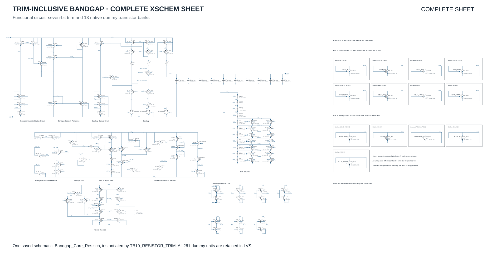
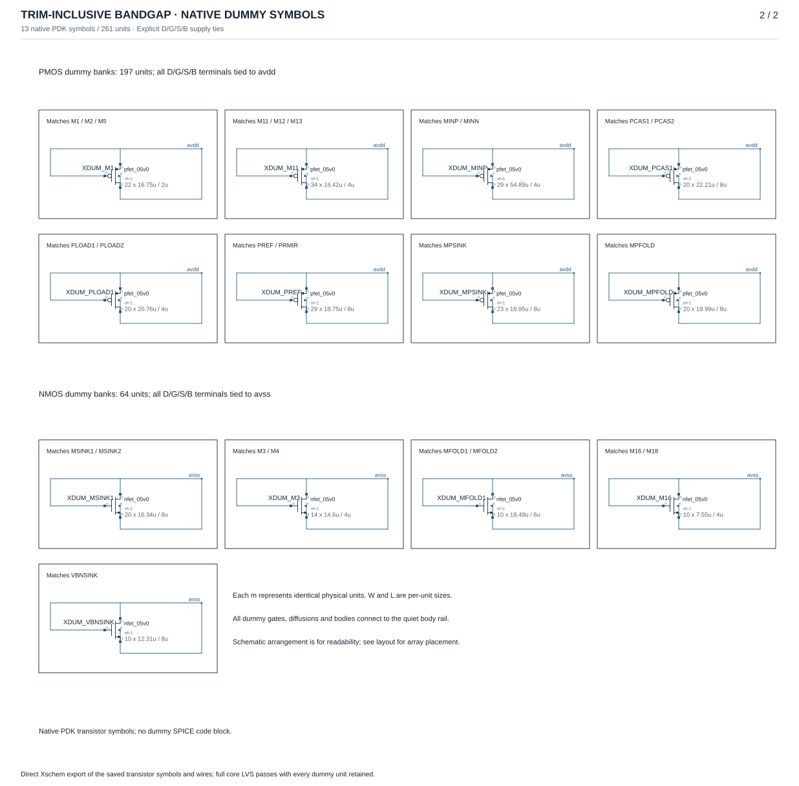

# Final trim-inclusive Xschem schematic

[Back to README](../README.md#schematics) · [Editable Xschem source](../Bandgap_Core_Res.sch) · [Final testbench: TB10](../TB10_RESISTOR_TRIM.sch)

The final circuit is **Bandgap_Core_Res.sch**, instantiated by **TB10_RESISTOR_TRIM.sch**. The seven-bit resistor-trim network and all **13 native PDK dummy transistor symbols** are saved in that same editable schematic. The dummy symbols represent **261 physical units: 197 PMOS and 64 NMOS**, through their `m` properties.

## Complete sheet

[](images/bandgap-core-resistor-trim-complete.svg)

**Complete-sheet view.** A direct Xschem export of the entire final core, including the functional circuit on the left and the dummy transistor banks on the right. This is one sheet, with the saved symbol positions and wiring preserved. [Open the full-resolution vector image](images/bandgap-core-resistor-trim-complete.svg) to zoom into the labels; the two views below provide larger details.

## Functional circuit detail

[](images/bandgap-core-resistor-trim.svg)

The current core uses the PDK's `ppolyf_u_1k` resistor model. The seven trim-input buffers are arranged in two rows. This detail is a crop of the same saved sheet shown above.

## Dummy transistor detail

[](images/bandgap-core-resistor-trim-dummies.svg)

Each editable symbol carries its own model, W/L and multiplicity; the displayed size line reads `m × W / L`. Explicit wires tie drain, gate, source and body to **AVDD for PMOS** or **AVSS for NMOS**. These are actual transistor symbols, not a SPICE code block. Panel positions are for readability; physical placement is shown in the [matched-array figure](../layout/figures/matched-arrays.pdf).

In Xschem, open `Bandgap_Core_Res.sch` and use **Zoom Full** to see both the functional circuit and the dummy banks. Opening TB10 shows the testbench and its core instance; descend into that instance to inspect these devices.

## Verification and provenance

The exported source and released GDS hashes match the archived native-symbol LVS check. It retains **272 functional units and 261 dummy units, 533 in total**, with no devices filtered. This documentation update does not change the schematic, netlist connectivity or layout; the existing LVS evidence applies to the exact exported source.

[LVS verification](../layout/release/schematic-symbols/verification.json) · [Full LVS log](../layout/release/schematic-symbols/filled_lvs.log) · [Export provenance and dummy inventory](images/trim-schematic-provenance.json) · [Reproduction script](scripts/render_schematics.py)

After selecting GF180MCU-D in the pinned environment, regenerate all three vector views with:

```bash
python docs/scripts/render_schematics.py
```

The earlier eight-run check confirmed that replacing the dummy code block with native transistor symbols left mirror matching and every PSRR sample unchanged at saved precision. It applies to the previous GDS and its ground-omitting extraction; see the [preserved simulation comparison](../layout/release/previous/native-symbol-simulations/README.md). Current routing and PSRR results are in the [compact routing review](../layout/reviews/2026-10-21-compact-routing/README.md).
