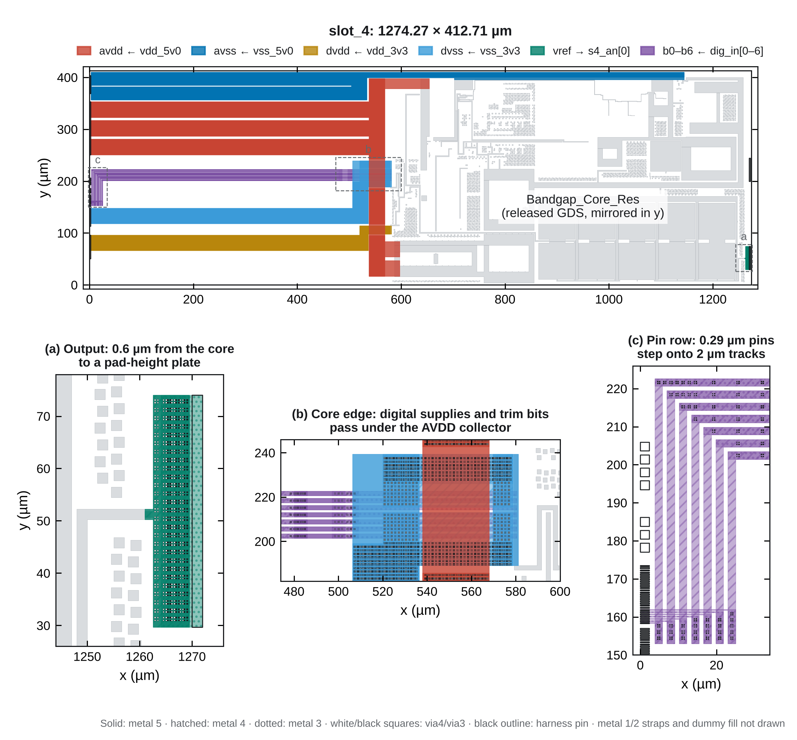

# Slot 4 integration - 13 November 2026

[`gds/slot_4.gds.gz`](../gds/slot_4.gds.gz) is the submission layout for slot 4 of the Chipalooza GF180MCU harness: top cell `slot_4`, the same outline, origin and pins as [`slot4_wrapper.gds`](../layout/harness/README.txt), with the released bandgap core inside and wired to the harness pins. It passes the installed, unedited foundry DRC (0 violations, 776 rules including antenna, density, dummy-fill and metal-slot checks) and LVS. The harness's own top-level assembly and LVS have not been run on it.



## What is in the slot

- **Core:** [`layout/release/Bandgap_Core_Res.gds`](../layout/release/Bandgap_Core_Res.gds), unmodified, as a child cell. It is mirrored about the x axis and placed flush against the pad side of the slot, at (578.6, 401.65) µm, so that its vref port lands at (1261.0, 51.25) µm inside the y span of the `s4_an[0]` pad pin. Mirroring keeps every gate orientation.
- **Wrapper contents:** boundary, pin metal, pin shapes and labels are copied verbatim from the harness wrapper, so the cell lines up with the frame when it is dropped over the wrapper.
- **Wiring:** planned rectangles only, declared in [`build_slot4.py`](../layout/scripts/build_slot4.py). Nothing is maze routed.
- **Dummy fill** in the otherwise empty area left of the core, with the same drawing rules as the core's fill.

## Pin map

| Core port | Harness pin | Notes |
| --- | --- | --- |
| `vref` | `s4_an[0]` | Dedicated pad, default 5 V analog pad `gf180mcu_ocd_io__asig_5p0` |
| `avdd` | `vdd_5v0` | Gated 5 V analog supply; the core is specified for 3.3 V to 5 V |
| `avss` | `vss_5v0` | |
| `dvdd` | `vdd_3v3` | Gated 3.3 V supply for the trim logic |
| `dvss` | `vss_3v3` | Kept separate from `avss` inside the slot |
| `b0` … `b6` | `dig_in[0]` … `dig_in[6]` | Trim code, 3.3 V logic; the review simulations use code 72 |

Unconnected, pin metal only: `s4_an[1]`, `dig_in[7..23]`, `dig_out[0..11]`, `analog_bus0..3`, `vbias`, `ibias0`, `ibias1`, `clk`, `reset`, `enable`.

## Traces

The output was the priority: the core's vref strap ends on the core edge and opens into the pad plate 0.6 µm later. The supplies then have to cross the 575 µm of empty slot between the pin row and the core, so they are wide and strapped on every metal.

| Net | Path | Width | Metals |
| --- | --- | ---: | --- |
| `vref` | 0.6 µm neck from the core's own 2 µm strap, then a plate 44.32 µm tall onto the pin; pin metal starts 8.03 µm from the core | 2 µm, then 44.32 µm | M5 and M4 to the plate, M5/M4/M3 plate, full via fields |
| `avdd` | Three stripes from the pin, 535 µm, into a vertical collector; two taps onto the PREF supply ring and one onto the M11–M13 spine | 3 × 30 µm; collector 30 µm; taps 30, 30 and 19 µm | M1–M5 strapped; taps M5 |
| `avss` | Two stripes from the pin, 531 µm, then a channel above the core that merges with the core's ground rail along 442.5 µm | 25.5 + 25.6 µm; channel 11.2 µm | Stripes M1–M5; channel M5 with 9.4 µm of M4 and M3 |
| `dvdd` | Stripe from the pin, 58.6 µm underpass below the AVDD collector, plate merged with the core's edge strap | 30 µm; underpass 16 µm | Stripe M1–M5; underpass M4+M3 |
| `dvss` | Stripe and riser from the pin, underpass, plate merged with the core's 50.4 µm edge strap | 30 µm; underpass 2 × 24 µm | Stripe M1–M5; underpass M4, M3 where the trim bits do not run |
| `b0`–`b6` | 0.29 µm pin lines step onto 2 µm pads within 25 µm of the pin row; 463–482 µm run; 23 µm bridge; 77 µm stub into the core pads | 2 µm | Run M3+M4 in parallel, bridge M5, stub M3; 12 cuts at each layer change |

No single piece of metal is wider than 30 µm, the limit above which the deck requires slots (MSLOT.1). Vias are 2 × 2 clusters on a fixed 1.6 µm lattice, dense where current changes layer and at least every 6.4 µm along the straps: 219,304 cuts in total.

The supply wiring is deliberately generous for a block that draws about 24–32 µA; it adds a small fraction of the supply-path resistance already inside the core (see the [power-rail review](POWER_RAIL_REVIEW.md)). No resistance or capacitance figure is quoted here because the slot wiring has not been extracted.

## Three things the first foundry run changed

The first version matched LVS but failed DRC with 17 violations. All three causes were fixed in the layout; no rule was waived or filtered.

1. **Density (DCF.1b, PL.8, M1.4–M4.4).** The deck measures density over the whole layout extent, and the left half of the slot was empty below metal 5. The supply stripes are now real M1–M5 stacks and the remaining area carries COMP, poly and metal dummy fill.
2. **Antenna (ANT.16_i_ANT.6, bits 5 and 6).** Metal-5 trim wires about 480 µm long connected directly to 3.3 V gates of 2.7 and 2.35 µm² gave ratios of 428 and 488 against a limit of 400. The long run is now on M3+M4 and reaches the core only through a short M5 bridge, so the long wire is not connected to the gates until the last metal is patterned.
3. **Dummy spacing (DM3.3).** The vref metal-3 plate was 0.6 µm from core dummy fill that reaches the core edge; it now starts 2.05 µm away.

## Verification

Run inside the pinned IIC-OSIC-TOOLS image by [`slot4-verify.yml`](../.github/workflows/slot4-verify.yml): [workflow run](https://github.com/jonahsaunders/gf180mcu_jonah_saunders_ip__bandgap/actions/runs/43534634469) at `c8464a4`. The printed verdict is saved as [`layout/slot4/verification.json`](../layout/slot4/verification.json).

| Check | Result |
| --- | --- |
| Rebuild from source equals the committed GDS | Yes; uncompressed SHA-256 `591e1952…9cbc35` |
| Foundry DRC, top cell `slot_4`, flat | 0 violations, 776 rules executed |
| Antenna rules | Part of the same deck run (24 rules); 0 violations |
| Density reported by the deck | COMP 38.2 %, poly 15.5 %, M1 48.6 %, M2 47.3 %, M3 50.1 %, M4 51.2 %, M5 54.1 % |
| Foundry LVS against [`slot_4.spice`](../layout/slot4/slot_4.spice) | Match; 113 combined devices on each side |
| Top-level nets extracted by LVS | `avdd,vdd_5v0` · `avss,vss_5v0` · `dvdd,vdd_3v3` · `dvss,vss_3v3` · `s4_an[0],vref` · `b0,dig_in[0]` … `b6,dig_in[6]` |

The extracted net names carry both the core label and the harness label, which shows each harness pin on the intended core net. [`slot_4.spice`](../layout/slot4/slot_4.spice) is the released core netlist with its ports renamed to the harness pins; the slot adds no devices.

Before the GDS is written, the builder itself checks every added shape against the flattened core and wrapper: clearances, via enclosure, dummy spacing, the 30 µm slot rule, the density minimums, and a metal-only connectivity extraction that requires each core port to merge with exactly its harness pin and nothing else.

## Rebuild

```sh
python3 layout/scripts/build_slot4.py          # writes gds/slot_4.gds.gz, slot_4.spice, slot_4_summary.json
python3 layout/scripts/build_slot4.py --check  # rebuilds in memory and compares
python3 layout/scripts/draw_slot4.py           # regenerates the figure
bash layout/verify_slot4.sh                    # foundry DRC and LVS, inside the pinned image
```

## Open items

These need a decision from the designer or the harness maintainer before the slot is frozen.

- **Harness top level not run.** The slot was verified on its own. The harness `get_project_gds.sh` placement, Magic/netgen top-level LVS and top-level fill were not run here.
- **`dig_out[11:0]` are left unconnected.** In the harness they feed a multiplexer input that is selected only when this slot's digital output is enabled. Leaving that enable off is sufficient; tying the twelve pins to `vss_3v3` inside the slot is the alternative if the maintainer prefers a defined level.
- **Trim-bit order.** The harness Verilog connects `dig_in[k]` to project bit `k`. The harness Xschem netlist lists the same bus in the opposite order, and the frame's slot-4 routing was not complete at harness commit `cd6eca2`. Confirm which register bit drives `dig_in[0]` before writing a trim code.
- **Trim code at power-up.** The core has no stored default; the reference comes up at whatever code the harness latches hold.
- **Output loading.** vref is a high-impedance output and the pad is a direct analog pad. Measure it with a high-impedance instrument or a buffer.
- **Supply choice.** `avdd` uses the gated 5 V rail and `dvdd` the gated 3.3 V rail. Confirm these are the intended operating supplies.
- **Harness wrapper version.** The copy in `layout/harness/` is from harness commit `cd6eca2` (2 November 2026). Rebuild and re-verify if the slot-4 wrapper changes.
- **No extraction or simulation of the slot wiring.** The post-layout results in this repository are for the core.

To freeze the slot, the harness `config.txt` needs this repository's URL as `s4_source` and the branch and commit as `s4_version`.

[Back to final integration](FINAL_INTEGRATION.md)
