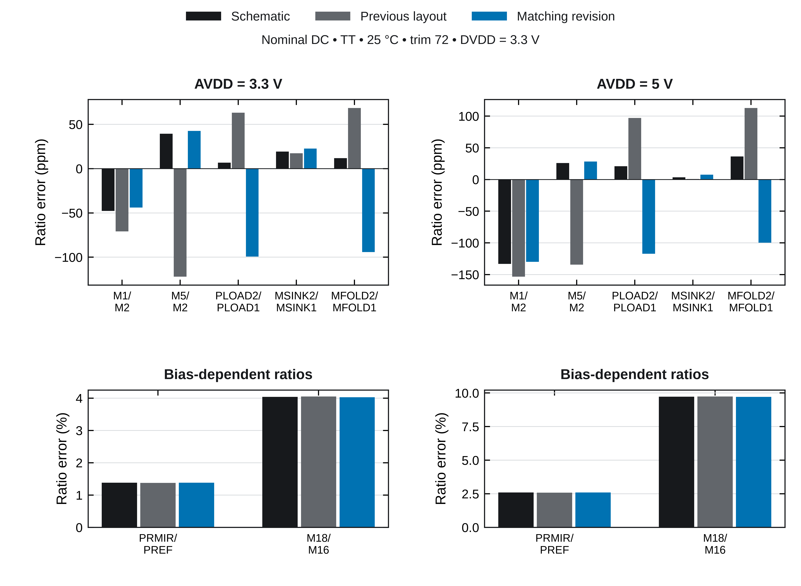

# Implemented mirror-layout revision

**21 October 2026 · Trim-inclusive TB10 core · DRC clean and LVS matched**

This revision implements the physical improvements from the [preceding review](../2026-10-21-mirrors/README.md). The core measures **686.0 × 399.6 µm** and contains **272 unchanged functional device units plus 261 explicit tied-off dummy MOS units**. The earlier compact layout is retained in Git at `f249c5c`; that same GDS was re-extracted with the current extraction anchors for the controlled before-layout baseline below. The original pre-layout temperature-trim study remains in the main README.

## Physical changes and verification

1. **Protected matching arrays.** All 13 selected MOS arrays have complete dummy perimeters, identical unit orientation, and quiet terminal ties: D/G/S/B to AVDD for PMOS or AVSS for NMOS. Dummies are present in the visible schematic netlist and included in the unedited LVS comparison. No dummy-device filtering is used.
2. **Balanced geometry.** The M1/M2/M5 cyclic pattern and the M11/M12/M13 pattern have equal centroids and equal second spatial moments within each group. The M3/M4 pair uses ABBA. Single-unit MFOLD1/MFOLD2 and M16/M18 are adjacent with common dummy surroundings; they are not described as common-centroid arrays. The odd-count input/bias pairs retain equal centroids, but their second moments are not equal.
3. **Local drain and source connections.** M1/M2/M5 have equal local M2/M3/M4 drain-route lengths, metal areas and via counts. The independent connectivity audit compares the actual GDS to that local routing plan with zero polygon XOR. Equal-length source escapes connect to 2 µm M3 row buses and a shared 2 µm M4 trunk, reducing differential supply drops. The source-bus geometry and all 18 connections are independently checked in GDS. This does not establish equal complete branch resistance or capacitance outside the array.
4. **Proximity and current paths.** Related bias devices are clustered, and the core mirrors, PNPs and PTAT resistor sit beside the trim ladder. Two-micrometer M5 reinforcement is added to VREF, PTAT and selected trim-current routes. Some optional M5 landings remain inaccessible; their verified lower-metal connections remain in place. These routes are not a Kelvin implementation or completed EM/IR signoff.
5. **Manufacturing and independent checks.** All 13 arrays have zero unrelated-net overlap over their channels and no metal-fill overlap. The complete unedited GF180MCU-D DRC deck reports **0 violations**, including density checks; LVS matches all **533 units**. Both extraction-topology LVS audits pass. A fresh source rebuild has zero GDS polygon/text differences.

*Actual saved placement. [Matching arrays](../../figures/matched-arrays.pdf) · [Annotated GDS](../../figures/physical-layout.pdf) · [Geometry audit](../../release/mirror_geometry_audit.json) · [Rebuild comparison](../../release/rebuild_equivalence.json).*

| Related devices | Previous separation | Revised separation |
| :--- | ---: | ---: |
| M16 / M18 | 14.15 µm | 8.40 µm |
| MFOLD1 / MFOLD2 | 193.90 µm | 10.40 µm |
| M3 / M4 | 18.20 µm | 0.00 µm |
| VBNSINK / MSINK1 | 92.05 µm | 195.05 µm |
| VBNSINK / MSINK2 | 92.05 µm | 195.05 µm |
| PREF / MPSINK | 304.13 µm | 180.52 µm |
| PREF / MPFOLD | 373.24 µm | 141.00 µm |
| N1 / NTAIL | 156.63 µm | 17.08 µm |
| N1 / N3 | 155.55 µm | 42.20 µm |

These decisions follow [GF180 MP.1–MP.13](https://gf180mcu-pdk.readthedocs.io/en/latest/physical_verification/design_manual/drm_10_6_2.html), [Cadence current-mirror layout guidance](https://community.cadence.com/cadence_blogs_8/b/cic/posts/current-mirrors-in-analog-layout), and [Lan et al., MWSCAS 1999](https://class.ece.iastate.edu/vlsi2/docs/Papers%20Done/1999-08-MWSCAS-ML.pdf). GF180 lists matching guidance among its [uncoded rules](https://gf180mcu-pdk.readthedocs.io/en/latest/physical_verification/design_manual/drm_16.html); DRC alone is not matching qualification. Dummy poly and metal fill follow the published [poly-fill](https://gf180mcu-pdk.readthedocs.io/en/latest/physical_verification/design_manual/drm_13_2.html) and [metal-fill](https://gf180mcu-pdk.readthedocs.io/en/latest/physical_verification/design_manual/drm_13_3.html) guidance.

## Nominal mirror matching

Typical process, 25 °C, trim 72, DVDD = 3.3 V. Each entry is **100 × (|Ia| / |Ib| − 1)**. Four new diagnostic DC runs use ideal series drain probes; their VREF values reproduce the independent nominal screens within **0.110 µV**. These are deterministic current ratios, not Monte Carlo mismatch results.

| Branch ratio | Schematic 3.3 V | Previous 3.3 V | Revised 3.3 V | Schematic 5 V | Previous 5 V | Revised 5 V |
| :--- | ---: | ---: | ---: | ---: | ---: | ---: |
| M1 / M2 | -0.0048% | -0.0071% | -0.0044% | -0.0133% | -0.0153% | -0.0130% |
| M5 / M2 | +0.0039% | -0.0122% | +0.0043% | +0.0026% | -0.0134% | +0.0028% |
| PLOAD2 / PLOAD1 | +0.0007% | +0.0063% | -0.0099% | +0.0021% | +0.0097% | -0.0117% |
| MSINK2 / MSINK1 | +0.0019% | +0.0017% | +0.0023% | +0.0003% | +0.0001% | +0.0008% |
| MFOLD2 / MFOLD1 | +0.0012% | +0.0068% | -0.0094% | +0.0036% | +0.0113% | -0.0100% |
| PRMIR / PREF | +1.3811% | +1.3798% | +1.3828% | +2.5946% | +2.5922% | +2.5969% |
| M18 / M16 | +4.0384% | +4.0486% | +4.0286% | +9.7232% | +9.7355% | +9.7124% |

*Upper panels use ppm; lower panels use percent. [Vector PDF](mirror-current-ratios.pdf) · [Per-unit currents and terminal biases](../../release/mirror_bias/summary.json).*

The larger M18/M16 and PRMIR/PREF errors already exist in the schematic. Their unequal drain biases and finite output resistance are consistent with those errors. Improved placement does not remove this circuit-level limitation.

The main M1/M2 and M5/M2 ratios improve at both supplies. This is not an improvement in every nominal ratio: PLOAD2/PLOAD1 changes from +0.0063% to −0.0099% at 3.3 V and from +0.0097% to −0.0117% at 5 V; the folded-pair error also increases in magnitude at 3.3 V. These small deterministic tradeoffs are retained in the table, alongside the improved physical matching environment. Statistical mismatch still requires a separate study.

## PSRR comparison

Minimum sampled PSRR over 1 Hz–1 MHz, 481 common frequency points. Both physical layouts use corrected Magic 8.3.685 extraction and the same capacitance-conserving RCC method. Temporary extraction-only ports anchor internal PNP/well-resistor nodes so extresist retains their connections; only the public 12-pin interface appears in simulation. Both independent topology LVS audits pass. The old GDS is unchanged; its rerun values differ slightly from the earlier published numbers because both layouts now use this same anchoring procedure. Raw exports and before-layout provenance are retained.

| AVDD | Previous RCC | Revised RCC | Change | Schematic |
| :--- | ---: | ---: | ---: | ---: |
| 3.3 V | 47.17 dB | 48.10 dB | +0.93 dB | 50.56 dB |
| 5 V | 52.12 dB | 53.37 dB | +1.25 dB | 52.04 dB |

The following model comparisons isolate contributions without treating them as additive physical gains. Coupling-removal rows are diagnostic counterfactuals, not achieved layout results.

| Diagnostic model | Minimum at 3.3 V | Minimum at 5 V |
| :--- | ---: | ---: |
| Schematic | 50.56 dB | 52.04 dB |
| Extracted devices, no wiring parasitics | 50.90 dB | 52.72 dB |
| Extracted devices + capacitance | 47.93 dB | 53.19 dB |
| Conserved RCC (delivered screen) | 48.10 dB | 53.37 dB |
| Diagnostic only: remove AVDD–vgn2 coupling | 50.51 dB | 53.76 dB |
| Diagnostic only: remove AVDD–xf2 coupling | 51.81 dB | 53.87 dB |

The RCC zero-wire-resistance response is checked against the capacitance-only response to within 0.001 dB over the full frequency grid. [AC conservation check](../../release/psrr/conservation_ac_check.json) · [Comparison numbers](comparison.json) · [All diagnostic AC metrics](../../release/psrr/summary.json).

Early trial placement increased the reference offset because of resistive voltage drops in longer VREF, trim and PTAT routes. Diagnostic zero-resistance counterfactuals identified those paths. Moving the compensation capacitor and startup detector closer to the amplifier reduced the sensitive vgn2 route. The final compact floorplan restores a two-row output-capacitor bank and places the precision core beside the trim ladder. The 1270 × 410 µm area is a maximum planning envelope, not a target to fill. Supply-coupling ablations identify remaining sensitive nodes; those counterfactual circuits are not delivered extraction models.

## Limits and reproduction

The RCC model omits AVSS/DVSS resistance and approximates distributed coupling placement. Statistical mismatch/trim yield, thermal and stress gradients, complete branch RC balance, EM/IR, stability, noise, loading, and final harness integration remain open. The 360-point fixed-code DC screen and nominal power-cycle tests are screening evidence, not full electrical qualification. The approximate 1270 × 410 µm area does not supply final boundary clearances or pin assignments.

Use the pinned container and [build instructions](../../README.txt). Run `build`, `extract`, `screen`, and `pvt`, then `audit_mirror_layout.py --release <build> --out <build>/mirror_review`, `screen_mirror_bias.py --build <build>`, and `diagnose_psrr.py --build <build> --output <build>/psrr_diagnostics --supply-coupling`. For archived release inputs, omit `--build` from the current-bias screen; results default to the ignored build directory. `render_matching_results.py` regenerates this review and its figure from archived evidence.

GDS SHA-256: `868a5339f5ba86624387fb1692e9608f3a689568eddaf98099092b62fe544b36`. [Release manifest](../../release/verification.json) binds physical checks and source/artifact hashes. [Functional-equivalence check](../../release/functional_equivalence.json) confirms unchanged functional geometry, connectivity and multiplicity.
