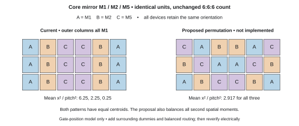
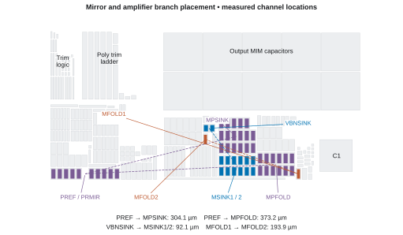

# Current-mirror layout review

> Historical audit of the earlier compact layout, preserved at `f249c5c`. See the [implemented revision](../2026-10-21-mirrors-implemented/README.md) for current geometry and results. Reproduction of this historical audit requires that earlier checkout.

**21 October 2026 · Trim-inclusive TB10 core · Physical revision recommended**

The layout has useful matching features, but it is not ready for analog matching signoff. Seven selected MOS groups have equal centroids and consistent orientation. The remaining concerns are unrelated routing over sensitive devices, unequal edge environments without matching dummies, and precision bias branches excluded from the placement groups. Four new nominal DC simulations separate these physical concerns from current-ratio errors already present in the schematic.

This is a review of the released **614.0 × 307.6 µm** core at repository commit `6d95063`. No schematic, GDS, extraction model, or existing simulation result was changed. The alternative array below is a proposal, not an implemented layout.

## What was checked

The audit recovered **237 MOS channels** from actual GDS active/poly intersections and checked unit dimensions and multiplicities against the circuit inventory. Metal/via connectivity independently agreed with all placed terminal nets across **73 logical nets**. Seven named matching groups have effectively zero centroid separation and identical unit geometry within each group; all use the same orientation. No metal fill overlaps their group bounds, and no MIM capacitor overlaps their channels. PMOS units within each selected array have equal local n-well area; this alone does not establish equal well-edge distance, stress, or tap resistance.

The existing release records **zero full-deck DRC violations and an LVS match**. Their file hashes were rechecked; the decks were not rerun for this read-only review. GF180 explicitly lists its matching guidelines among rules that are not coded, so those passes cannot establish matching quality. [GF180 uncoded rules](https://gf180mcu-pdk.readthedocs.io/en/latest/physical_verification/design_manual/drm_16.html).

## Findings that should drive the next physical revision

### 1. Remove unrelated routes above matched channels — high priority

**Six of seven** selected MOS groups have unrelated conducting nets crossing their channels. The audit identifies each net through extracted metal connectivity, then intersects its polygons with the actual channels. These are coupling/environment concerns, not shorts.

| Group | Example unrelated route | Measured channel overlap |
| :--- | :--- | ---: |
| PREF / PRMIR | `net3`, M3 | 22.71 µm² |
| MINP / MINN input pair | `vbn_i`, M2 | 18.02 µm² |
| MINP / MINN input pair | `vsu`, M3 | 16.76 µm² |
| PCAS1 / PCAS2 | `psrg_vnc`, M3 | 23.26 µm² |
| MSINK1 / MSINK2 | `iref_gate`, M2 | 19.20 µm² |
| M11 / M12 / M13 | `vsu1`, M2 + M3 | 20.02 µm² |
| PLOAD1 / PLOAD2 | `vsua`, M2 | 9.60 µm² |
| M1 / M2 / M5 | None detected | 0 |

The input pair has eleven such nets, including ground. A deliberate ground shield needs separate assessment; the startup and other bias crossings are the clearer problems. Add routing exclusion regions around sensitive arrays and route their own connections symmetrically. Do not infer a numerical PSRR penalty from overlap area alone.

GF180's guidance calls for identical unit layout, proximity, equal surroundings, similar corresponding interconnect, consistent orientation and well type, and suitable bias symmetry. It recommends surrounding dummies and excludes unrelated conductors over or under matched devices. Those requirements extend beyond equal centroids. [GF180 matched-pair guidance, MP.1–MP.13](https://gf180mcu-pdk.readthedocs.io/en/latest/physical_verification/design_manual/drm_10_6_2.html).

### 2. Balance edge environments and add explicit matching dummies — high priority

The generator contains no explicit edge dummy MOS devices. The core M1/M2/M5 array repeats `A B C C B A` on all three rows: **every M1 unit occupies an outer column**, while M2 and M5 occupy interior columns. PREF/PRMIR and MINP/MINN also give one member both outermost positions. Equal centroids do not correct this environmental asymmetry.



*Figure 1. A = M1, B = M2, C = M5. Both arrays preserve six identical units per device and equal centroids. The proposed cyclic row permutation also equalizes all second spatial moments of the unit-channel positions. It has not been routed, extracted, or electrically qualified. [PDF](mirror-array-review.pdf) · [600-dpi PNG](mirror-array-review.png).*

The current normalized x² moments are **6.25, 2.25, and 0.25**; the proposal gives **35/12 for all three**. This is a useful geometric improvement, not a mismatch-yield prediction. Add a complete perimeter of identical dummy units with documented, quiet terminal ties and an LVS treatment. Density fill and an empty center site are not matching dummies. Review M11/M12/M13's unequal second moments as well.

Cadence emphasizes consistent unit geometry, orientation, guard structures, and local surroundings in current-mirror layout. Research also shows why a common centroid alone does not eliminate all spatially distributed transistor mismatch. [Cadence layout guidance](https://community.cadence.com/cadence_blogs_8/b/cic/posts/current-mirrors-in-analog-layout), [Lan, Tammineedi and Geiger, MWSCAS 1999](https://class.ece.iastate.edu/vlsi2/docs/Papers%20Done/1999-08-MWSCAS-ML.pdf).

### 3. Place complete precision bias families together — high priority

The hand-selected arrays do not cover every related analog branch. Grouping devices by electrical gate/source/body connections reveals these separations:

| Reference and branch | Channel-centroid distance | Interpretation |
| :--- | ---: | :--- |
| PREF → MPSINK | 304.1 µm | Related PMOS bias family |
| PREF → MPFOLD | 373.2 µm | Related PMOS bias family |
| VBNSINK → MSINK1/2 | 92.1 µm | Reference outside its output pair |
| N1 → NTAIL | 156.6 µm | Related NMOS bias family |
| MFOLD1 → MFOLD2 | 193.9 µm | Folded-amplifier counterparts; not a simple mirror |
| M16 → M18 | 14.2 µm | Already close; bias asymmetry is more significant |



*Figure 2. Colored rectangles are actual MOS channel locations over the placed device bounds. Dashed lines connect selected related branches; they are not electrical routes. Distances use the mean channel coordinates of each multi-unit device. [PDF](mirror-placement-review.pdf) · [600-dpi PNG](mirror-placement-review.png).*

Cluster reference and output devices by circuit role, and bring the folded-amplifier counterparts into comparable local environments. Some members intentionally have different widths and multiplicities: preserve their designed ratios rather than making all devices the same size. Startup and supply-detection branches sharing a bias gate should not automatically be treated as precision mirrors. Any unit repartitioning requires schematic-equivalent geometry and fresh electrical checks.

The provisional **1270 × 410 µm** harness area leaves room for local dummies, isolation, and routing. It does not justify spreading the analog circuitry across the full width. Final harness pins and boundaries remain unassigned.

### 4. Balance branch interconnect and verify returns — medium priority

The `xf1` and `xf2` routing trees measure **323.2 and 280.0 µm**, with **12 and 16 M2–M3 vias**. `pm1` and `pm2` also differ in length and via count. These whole-net measurements flag asymmetric routing; they do not measure individual branch resistance or prove a current error, because fanout and topology differ.

Match corresponding source/drain access, layer changes, and return paths using per-branch extracted resistance and capacitance. Inspect body-tie connectivity and guard continuity in the same pass. The current RCC approximation omits ground resistance, so it cannot establish equal AVSS/DVSS return drops or complete supply/ground matching. Thermal gradients, well proximity, stress, and EM/IR also remain outside this audit.

## What the new DC runs establish

Conditions: **typical process, 25 °C, trim code 72, DVDD = 3.3 V**, with AVDD at 3.3 V and 5 V. Ideal zero-volt series drain probes were added only to diagnostic circuit copies. The diagnostic VREF values reproduce the saved nominal screens within **0.11 µV**. The RCC model is the existing capacitance-conserving approximation, including its documented ground-resistance limitation.

The table reports **100 × (|Iₐ|/|Iᵦ| − 1)**; these are nominal branch ratios, not statistical mismatch.

| Branch ratio a/b | Schematic, 3.3 V | RCC, 3.3 V | Schematic, 5 V | RCC, 5 V |
| :--- | ---: | ---: | ---: | ---: |
| M1 / M2 | −0.0048% | −0.0071% | −0.0133% | −0.0153% |
| M5 / M2 | +0.0039% | −0.0122% | +0.0026% | −0.0134% |
| PRMIR / PREF | +1.3811% | +1.3794% | +2.5946% | +2.5916% |
| M18 / M16 | +4.0384% | +4.0452% | +9.7231% | +9.7290% |
| PLOAD2 / PLOAD1 | +0.0007% | +0.0063% | +0.0021% | +0.0097% |
| MSINK2 / MSINK1 | +0.0019% | +0.0017% | +0.0003% | +0.0001% |
| MFOLD2 / MFOLD1 | +0.0012% | +0.0068% | +0.0036% | +0.0113% |

The main core mirror tracks within **0.02%** at both nominal supplies. That is encouraging, but these deterministic models do not establish fabrication mismatch yield.

M16/M18's difference is already present before layout. Their RCC VDS values are approximately **0.775/1.948 V at AVDD = 3.3 V**, and **0.775/3.634 V at AVDD = 5 V**. Unequal drain bias and finite output resistance are consistent with the ratio error; placement alone will not resolve it. PREF/PRMIR likewise have unequal drain bias and a similar pre-layout/post-layout ratio difference. Review the acceptable bias error and available headroom before deciding whether the circuit needs additional regulation or different sizing.

## Recommended implementation order

1. Define every precision mirror/amplifier family from the schematic, retaining intended ratios and recording required bias accuracy.
2. Repack those families, balance unit patterns, and add documented perimeter dummies and consistent local well/tap environments.
3. Reserve routing exclusions, balance corresponding connections, and shorten the amplifier's sensitive connections without degrading isolation.
4. Rerun unmodified DRC and LVS, extraction/topology checks, and before/after DC and PSRR. Confirm improvements against the same extraction model.
5. Complete process/voltage/temperature, mismatch and trim-yield, startup, stability, noise, loading, device-voltage, and supply/return checks before claiming analog qualification.

## Evidence and reproduction

The reviewed GDS SHA-256 is:

```text
86c11f6ccd18e887284f187bb1635ce37da98bfc5e14b5d436efcd7a043bfa00
```

- [Geometry, connectivity, family inventory and route intersections](mirror_geometry_audit.json)
- [Four DC runs, per-device currents and terminal voltages](bias/summary.json)
- [Archived schematic/model input provenance](bias/input_manifest.json); each case directory contains the diagnostic circuit, test deck and complete ngspice log
- [Proposed pattern arithmetic, explicitly unimplemented](proposed_pattern_check.json)
- [Review artifact checksums and checks](verification.json)
- [Existing release verification](https://github.com/jonahsaunders/gf180mcu_jonah_saunders_ip__bandgap/blob/f249c5c20f6bf5a216d05d3941f191dc6a567b2a/layout/release/verification.json) and [tool/extraction limitations](../../README.txt)

Use the pinned IIC-OSIC-TOOLS container in the layout reproduction guide. With this repository mounted as `/design`, run:

```bash
python /design/layout/scripts/audit_mirror_layout.py
python /design/layout/scripts/screen_mirror_bias.py
python /design/layout/scripts/render_mirror_review.py
```

The geometry audit uses KLayout's Python module. The four DC runs use ngspice and the container's GF180 models; archived schematic/model inputs allow reproduction without an ignored build directory. If a TB10 build netlist is present, its model header and core subcircuit must agree with the archive. Rendering uses Matplotlib. The scripts validate inputs and write review outputs; they do not modify the released design.
